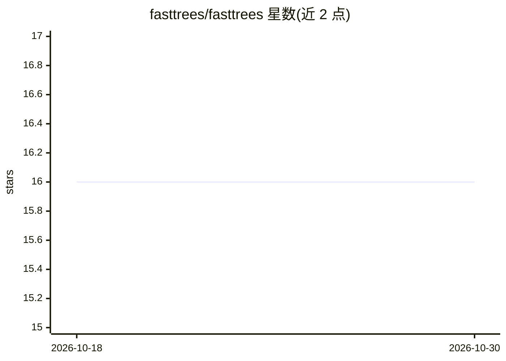

# fasttrees/fasttrees

⭐ 16 · Python · MIT · 推送 2026-08-27 · [GitHub](https://github.com/fasttrees/fasttrees) · [官网](https://fasttrees.github.io/fasttrees/) · 个人维护

**scikit-learn 风格的快速节俭树分类器**

基于 Python scikit-learn 实现的 fast-and-frugal tree（快速节俭树）分类器 FastFrugalTreeClassifier，用于不确定性条件下的分类决策。此类树结构简单、透明，对数据噪声与误差具有稳健性，方法源自 Gerd Gigerenzer 的快速节俭启发式研究，实现参考 R 包 FFTrees。以 pip 包形式提供，遵循 sklearn 的 fit/score 使用模式，README 给出 iris 数据集示例。MIT 许可，遵循 REUSE 标准。

## 筛选速览

| 维度 | 判定 | 备注 |
|---|---|---|
| AI 角色 | `ai-native` | 本体是模型或模型工具 |
| 许可风险 | `permissive` | MIT |
| 部署形态 | `library` | 以包/库形式分发 |
| 模型依赖 | — | README 未给出锁定关系 |
| 硬件要求 | — | 无带数字的原话,不猜 |
| 安装摩擦 | `low` | 无编译、无系统依赖或容器化 |
| 成熟度 | — | 结构信号不足 |

## 能力要点

- 提供 FastFrugalTreeClassifier 分类器，兼容 sklearn 接口
- 实现参考 R 包 FFTrees，基于快速节俭启发式
- 树结构透明，适用于不确定性下的决策

## 适用场景

- 在 sklearn 工作流中构建简单透明的分类树
- 对噪声与误差敏感的数据做稳健分类
- 复现快速节俭树启发式的决策分析

## 场景标签

 · 领域:数据科学/机器学习

## 证据(README 行号)

> L8: A fast-and-frugal-tree classifier based on Python's scikit learn.
> L10: Fast-and-frugal trees are classification trees that are especially useful for making decisions under uncertainty.

## 星数曲线

2026-10-18 16 → 2026-10-30 16（+0）

---
*卡片 v1 · prompt 1.4 · 生成 2026-10-30 · 置信度 high · 依据 README sha `fc5dda44c4ce` · [字段定义](../../DATASET.md)*
