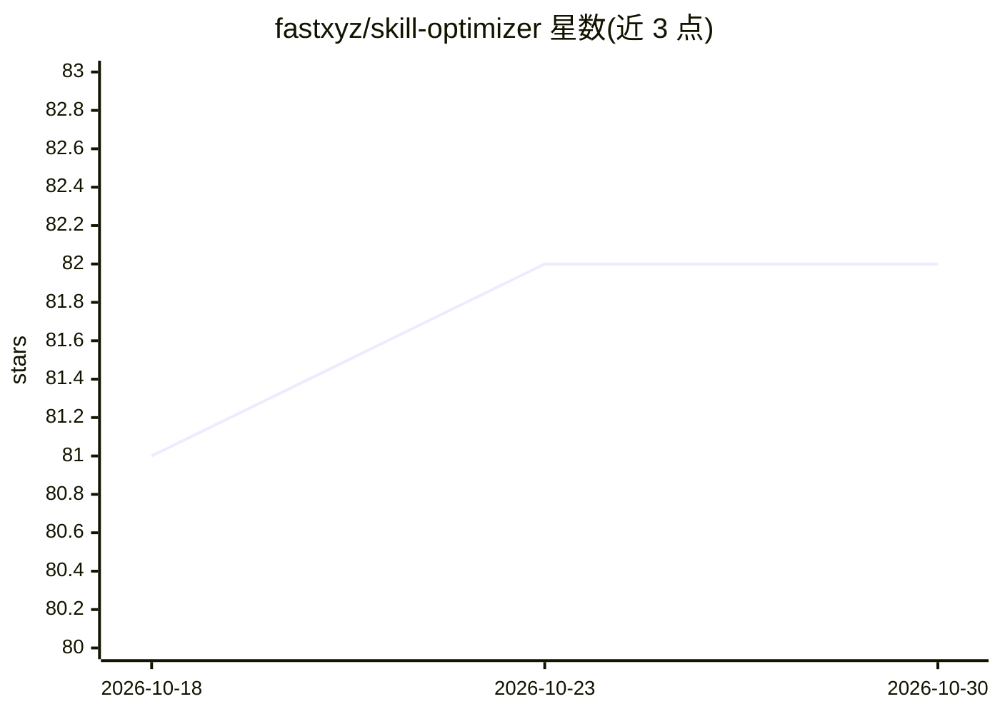

# fastxyz/skill-optimizer

⭐ 82 · TypeScript · MIT · 推送 2026-05-28 · [GitHub](https://github.com/fastxyz/skill-optimizer) · 组织维护

**在 Docker 中对 agent 技能做确定性评测的 CLI 与插件**

面向 agent 技能（skill）的评测工具：以 Docker 工作台隔离运行用户式任务，agent 阶段仅可见 /work 目录，之后由确定性 grader 检查文件、命令日志、answer.json 等本地状态判定成败。支持将 skill 作为插件安装到 Claude Code、Codex、Cursor、OpenCode、Gemini CLI 等环境，或以本地 CLI 按 suite（用例×OpenRouter 模型矩阵）批量执行。限制：仅支持 openrouter/... 模型引用，运行需 Node.js 20+、Docker 与 OPENROUTER_API_KEY。

## 筛选速览

| 维度 | 判定 | 备注 |
|---|---|---|
| AI 角色 | `ai-ecosystem` | LLM/agent 周边工具 |
| 许可风险 | `permissive` | MIT |
| 部署形态 | `self-host` | docker 或自建部署 |
| 模型依赖 | locked-api |  |
| 硬件要求 | — | 无带数字的原话,不猜 |
| 安装摩擦 | `low` | 无编译、无系统依赖或容器化 |
| 成熟度 | — | 结构信号不足 |

## 能力要点

- case（任务+grader）与 suite（用例×OpenRouter 模型矩阵）两级评测结构
- Docker 隔离工作台：agent 阶段不可见 grader 与答案，事后确定性评分
- 附 PDF 提取与隐藏 MCP 计算器服务两个示例套件
- 支持作为插件/skill 安装到 Claude Code、Codex、Cursor、OpenCode、Gemini CLI

## 适用场景

- 给自研 agent 技能写评测用例并跨模型跑分
- 验证技能更新后在多个 LLM 上的表现是否稳定
- 在 CI 或本地批量执行技能评测套件

## 场景标签

`模型评测` · 领域:评测与运维

## 证据(README 行号)

> L3: Docker workbench and Agent Skill for running deterministic evals against agent skills.
> L8: - Run the local CLI to execute cases and suites in Docker against OpenRouter models.
> L150: - A suite is a matrix of cases and OpenRouter models.

## 星数曲线

2026-10-18 81 → 2026-10-30 82（+1）

---
*卡片 v1 · prompt 1.4 · 生成 2026-10-24 · 置信度 high · 依据 README sha `abcba1cabf3c` · [字段定义](../../DATASET.md)*
