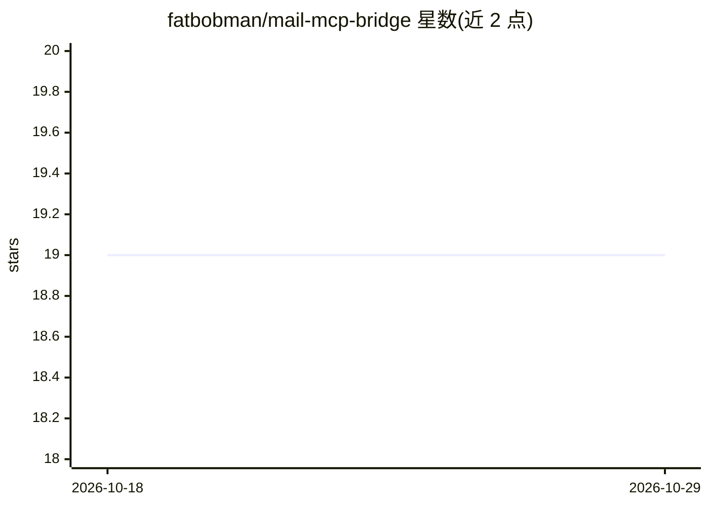

# fatbobman/mail-mcp-bridge

⭐ 19 · Python · MIT · 推送 2026-04-12 · [GitHub](https://github.com/fatbobman/mail-mcp-bridge) · [官网](https://fatbobman.com) · 个人维护 · 中文 README

**通过 MCP 让 AI 助手直接读取 macOS Mail 邮件的本地桥接服务**

面向 macOS 用户的 MCP 服务器：AI 助手（如 Claude Desktop）通过它读取本机 Mail.app 的邮件内容。工作流为在 Mail 中用快捷键复制 Message-ID，粘贴给 AI，即可读取单封邮件、整个会话线程及附件（PDF/文档/图片）。提供 6 个 MCP 工具（读取邮件、读取线程、提取附件、清理临时文件等），并附带 Claude Code 插件（附件智能分析、行动项提取、3 种分析模式）。本地运行，仅读取邮件数据，不外发。要求 macOS 12.0+ 与 Python 3.9+。

## 筛选速览

| 维度 | 判定 | 备注 |
|---|---|---|
| AI 角色 | `ai-ecosystem` | LLM/agent 周边工具 |
| 许可风险 | `permissive` | MIT |
| 部署形态 | `library` | 以包/库形式分发 |
| 模型依赖 | locked-api |  |
| 硬件要求 | — | 无带数字的原话,不猜 |
| 安装摩擦 | `low` | 无编译、无系统依赖或容器化 |
| 成熟度 | — | 结构信号不足 |

## 能力要点

- 6 个 MCP 工具：读邮件/读线程/提取附件/清理临时文件等
- Message-ID 复制粘贴工作流，支持整个会话线程检索
- 附带 Claude Code 插件（附件智能分析、行动项提取、3 种分析模式）
- 本地运行、只读、无遥测，邮件数据不离开 Mac

## 适用场景

- 让 AI 总结冗长的邮件往来并提取需求、承诺与行动项
- 让 AI 分析邮件中的 PDF 发票、合同等附件
- 通过 Message-ID 追踪项目邮件线程的进展

## 场景标签

 · 领域:AI 工具集成/邮件

## 证据(README 行号)

> L5: **Mail MCP Bridge** enables AI assistants (like Claude, ChatGPT) to directly access and analyze your macOS Mail emai
> L36: - 📧 **Direct Access** - AI reads your emails through MCP protocol

## 星数曲线

2026-10-18 19 → 2026-10-29 19（+0）

---
*卡片 v1 · prompt 1.4 · 生成 2026-10-28 · 置信度 mid · 依据 README sha `2c5868ee5a92` · [字段定义](../../DATASET.md)*
