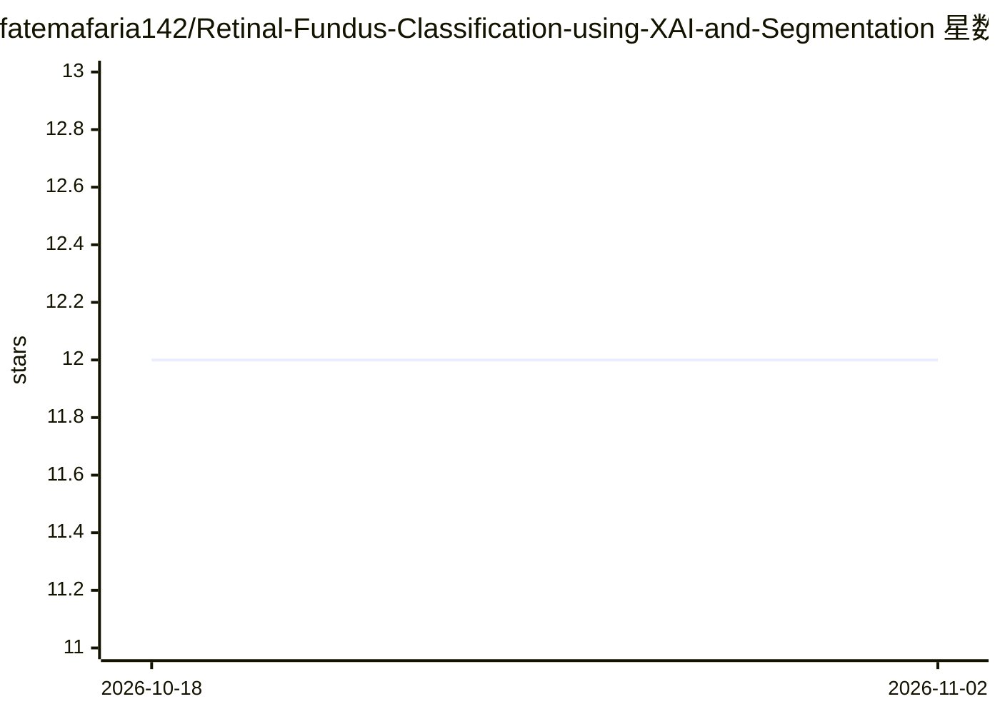

# fatemafaria142/Retinal-Fundus-Classification-using-XAI-and-Segmentation

⭐ 12 · Jupyter Notebook · MIT · 推送 2026-08-29 · [GitHub](https://github.com/fatemafaria142/Retinal-Fundus-Classification-using-XAI-and-Segmentation) · 组织维护

**眼底图像分类与视网膜血管分割研究：CNN+XAI 对比实验**

一项医学影像研究代码库：在 FIVES 数据集上用 8 个预训练 CNN 做眼底图像分类，并用 Grad-CAM、Grad-CAM++、Score-CAM、Faster Score-CAM、Layer CAM 五种可解释 AI 方法可视化决策依据；另在 DRIVE 与 FIVES 数据集上评估 10 个分割模型（TransUNet、Attention U-Net 配多种 ResNet/DenseNet 骨干、Swin-Unet）。README 报告 ResNet101 分类准确率 94.17%，并列出各模型 IoU、Dice 等指标。面向科研复现者，未提供安装或运行命令，实验环境为 Kaggle T4 GPU 与本地 Jupyter。

## 筛选速览

| 维度 | 判定 | 备注 |
|---|---|---|
| AI 角色 | `ai-native` | 本体是模型或模型工具 |
| 许可风险 | `permissive` | MIT |
| 部署形态 | `None` |  |
| 模型依赖 | — | README 未给出锁定关系 |
| 硬件要求 | — | 无带数字的原话,不猜 |
| 安装摩擦 | `low` | 无编译、无系统依赖或容器化 |
| 成熟度 | — | 结构信号不足 |

## 能力要点

- 8 个预训练 CNN 的眼底图像分类对比实验
- Grad-CAM/Grad-CAM++/Score-CAM/Faster Score-CAM/Layer CAM 五种可解释性方法
- 10 个分割模型（TransUNet/Attention U-Net/Swin-Unet 等）在 DRIVE 与 FIVES 上评估
- 完整指标表格：Accuracy、IoU、Dice、Hausdorff 距离等

## 适用场景

- 复现眼底图像分类与血管分割的对比实验结果
- 比较各 CNN 与 U-Net 变体在医学分割任务上的指标
- 查看可解释 AI 热力图以理解模型决策区域

## 场景标签

`科研工具` `目标检测` · 领域:学习与行业

## 证据(README 行号)

> L4: Our research focuses on the critical field of early diagnosis of disease by examining retinal blood vessels in fundu
> L38: For classification purposes, the FIVES Database was employed, while for segmentation tasks, two databases were util

## 星数曲线

2026-10-18 12 → 2026-11-02 12（+0）

---
*卡片 v1 · prompt 1.4 · 生成 2026-11-01 · 置信度 high · 依据 README sha `2f6bf4796d98` · [字段定义](../../DATASET.md)*
