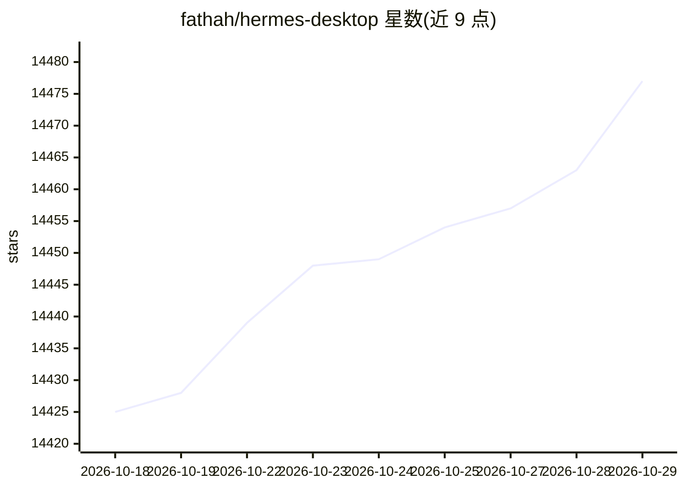

# fathah/hermes-desktop

⭐ 14,477 · TypeScript · MIT · 推送 2026-10-13 · [GitHub](https://github.com/fathah/hermes-desktop) · [官网](https://hermesone.org) · 组织维护 · 中文 README

**为 Hermes Agent 提供安装、配置与对话的桌面应用**

社区维护的原生桌面应用，把 Hermes Agent 的安装、provider 配置与日常使用集中到 GUI：首次启动引导本地安装（调用官方安装脚本，存放于 ~/.hermes）或连接远程 API，本地模式经 127.0.0.1:8642 以 SSE 流式通信。覆盖会话管理、多 Profile 隔离、记忆条目编辑、SOUL.md 人格编辑、cron 定时任务、16 个消息网关与备份/日志查看。API key 默认存于 .env，可选 command provider 对接多种密码管理器；该 provider 仅限 POSIX 系统。项目处于活跃开发期。

## 筛选速览

| 维度 | 判定 | 备注 |
|---|---|---|
| AI 角色 | `ai-ecosystem` | LLM/agent 周边工具 |
| 许可风险 | `permissive` | MIT |
| 部署形态 | `library` | 以包/库形式分发 |
| 模型依赖 | local-ok | 支持本地模型 |
| 硬件要求 | — | 无带数字的原话,不猜 |
| 安装摩擦 | `low` | 无编译、无系统依赖或容器化 |
| 成熟度 | `idea` | |

## 动量与使用信号

- 维护:`active` — 距上次 push 4.7 天,年发版 48,81 位贡献者
- 涨星:近 1 天 **+4**(自 20261016 起算)
- 下载:GitHub Release 附件 累计 1,860,079(48 个 release)
- 平台:WINDOWS · 协议:OPENAI-API / OLLAMA

## 能力要点

- 引导式首次安装 Hermes Agent（本地/远程两种模式）
- 多 provider 支持：OpenRouter、Anthropic、OpenAI、Gemini、Grok 等 11 类及 OpenAI 兼容本地端点
- 22 个 slash 命令与 14 个工具集（浏览器、终端、图像生成、TTS 等）
- secrets command provider 可对接 KeePassXC、GnuPG、pass、1Password CLI 等

## 适用场景

- 不想手动操作 CLI、用图形界面安装和管理 Hermes Agent
- 在本地运行 Ollama/LM Studio 等模型端点并与桌面聊天 UI 配合
- 通过 Telegram/Discord/微信等消息平台接入同一个 agent

## 场景标签

`聊天机器人` · 领域:对话与助手

## 证据(README 行号)

> L26: Hermes One is a community maintained native desktop app for installing, configuring, and chatting with Hermes Agent
> L88: - **Multi-provider support** — OpenRouter, Anthropic, OpenAI, Google (Gemini), xAI (Grok), Nous Portal, Qwen, MiniM

## 星数曲线

2026-10-18 14,425 → 2026-10-29 14,477（+52）

---
*卡片 v1 · prompt 1.4 · 生成 2026-10-18 · 置信度 mid · 依据 README sha `c46bad7f5c71` · [字段定义](../../DATASET.md)*
