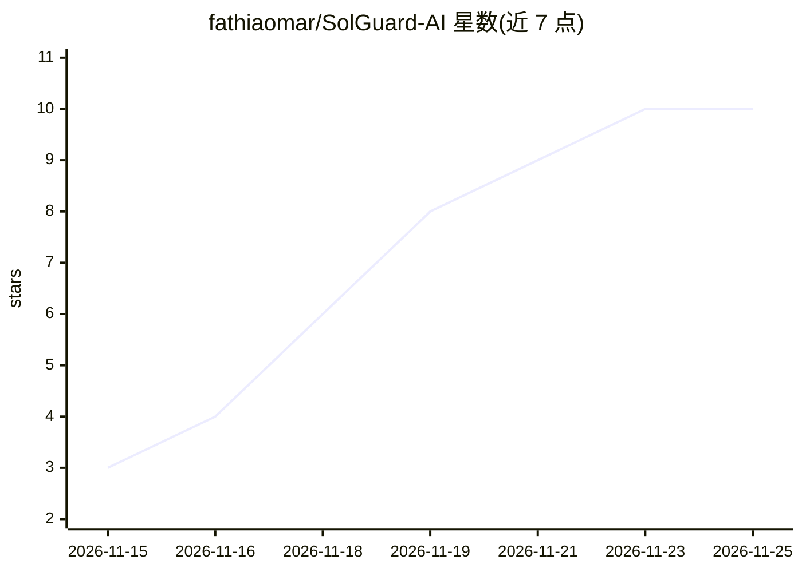

# fathiaomar/SolGuard-AI

⭐ 10 · JavaScript · MIT · 推送 2026-11-20 · [GitHub](https://github.com/fathiaomar/SolGuard-AI) · [官网](https://sol-guard-ai-47px.vercel.app/) · 个人维护

**给 Solidity 开发者的 AI 合约安全审计工作台**

基于 Next.js 构建的 Solidity 合约管理工作区：上传 .sol 文件后可执行静态 AST 模式扫描并定位源码位置，用户显式同意后将合约提交至 OpenAI 获得漏洞审查发现，支持严重度分级的结构化报告、JSON/Markdown 导出，以及仅限 SPDX 头的保守补丁应用。使用 Supabase 提供认证、数据库存储与文件存储，配置 AI 配额。README 明确声明结果仅为分诊辅助，非安全保证，需人工复核。

## 筛选速览

| 维度 | 判定 | 备注 |
|---|---|---|
| AI 角色 | `ai-native` | 本体是模型或模型工具 |
| 许可风险 | `permissive` | MIT |
| 部署形态 | `library` | 以包/库形式分发 |
| 模型依赖 | — | README 未给出锁定关系 |
| 硬件要求 | — | 无带数字的原话,不猜 |
| 安装摩擦 | `low` | 无编译、无系统依赖或容器化 |
| 成熟度 | `idea` | |

## 能力要点

- AI 辅助漏洞审查（OpenAI 模型，经用户同意后提交）
- 静态 AST 模式扫描并给出源码位置
- 严重度分级的结构化审计报告，支持 JSON/Markdown 导出
- Supabase 认证、持久化与行级安全

## 适用场景

- 上传 Solidity 合约获得 AI 漏洞审查提示
- 管理多个项目的合约文件与历史审计记录
- 对合约源码做静态模式检查作为人工审计前置步骤

## 场景标签

`网络安全` `代码审查` · 领域:编码与开发

## 证据(README 行号)

> L17: I created SolGuard AI to bring Solidity contract management and security review into one workspace. It lets develop
> L27: - **AI-assisted vulnerability review** — submit the selected contract to OpenAI after explicit consent, and save th
> L29: - **Structured audit reports** — review searchable findings, severity triage, gas review prompts, best-practice sug

## 星数曲线

2026-11-15 3 → 2026-11-25 10（+7）

---
*卡片 v1 · prompt 1.4 · 生成 2026-11-20 · 置信度 high · 依据 README sha `67bfb67e8081` · [字段定义](../../DATASET.md)*
