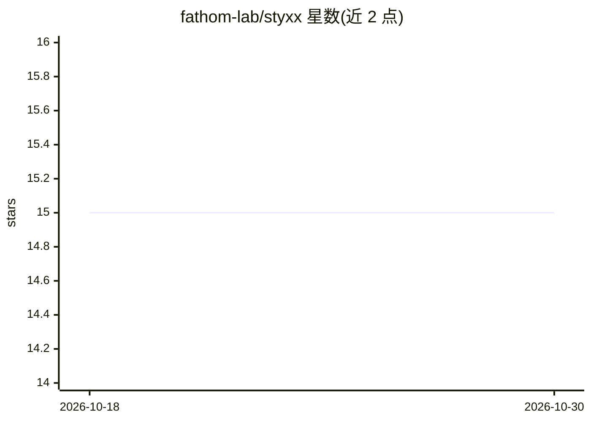

# fathom-lab/styxx

⭐ 15 · Python · MIT · 推送 2026-10-26 · [GitHub](https://github.com/fathom-lab/styxx) · [官网](https://styxx-org.netlify.app) · 组织维护

**校验 AI agent 声明与代码字节是否一致的验证工具集**

面向 agent 时代的验证层，提供三层工具：VERIFY 层将 agent 写的 PR 摘要与实际 diff 对照并报告矛盾（diffgate 及 GitHub Action，默认仅报告不阻断，soft-fail: false 才阻断）；MEASURE 层测度模型间概念几何（islands 等）；SENSE 层处理感知通道。核心机制是预注册评估与留痕：外部审计 EXTERNAL-1 实测指控精度 0.23，低于预注册的 0.95 门槛，path 类指控已在代码中停用。以 pip 包、Python 模块与 GitHub Action 形式提供，给做 CI 代码审查与 agent 可靠性验证的开发者使用。

## 筛选速览

| 维度 | 判定 | 备注 |
|---|---|---|
| AI 角色 | `ai-ecosystem` | LLM/agent 周边工具 |
| 许可风险 | `permissive` | MIT |
| 部署形态 | `library` | 以包/库形式分发 |
| 模型依赖 | — | README 未给出锁定关系 |
| 硬件要求 | — | 无带数字的原话,不猜 |
| 安装摩擦 | `low` | 无编译、无系统依赖或容器化 |
| 成熟度 | `idea` | |

## 能力要点

- diffgate 读取 PR 摘要并与 diff 对照，无需 checkout
- GitHub Action 一行接入 CI，默认报告模式
- 预注册（preregistration）与盲评 panel 的评估流程，附回执文件
- 71,016 条 agent PR 上实测指控精度 0.23，path 类指控已停用（WITHHOLD_PATH_ACCUSATION = True）

## 适用场景

- 在 CI 中核对 agent 生成的 PR 描述是否与实际改动相符
- 审查 AI agent 的工作声明并获取可追溯的评估回执
- 研究模型间概念几何的收敛与不可读性（islands/coupling）

## 场景标签

`代码审查` · 领域:编码与开发

## 证据(README 行号)

> L29: |**VERIFY**|does this claim match its evidence?|`certify` (OATH) · `protocol` · `seal` · `diffgate` + the GitHub Ac
> L47: ```bash
> L63: - uses: fathom-lab/styxx@main    # reports every agent PR body against its diff; blocks only with soft-fail: "false

## 星数曲线



2026-10-18 15 → 2026-10-30 15（+0）


---
*卡片 v1 · prompt 1.4 · 生成 2026-10-30 · 置信度 high · 依据 README sha `fa6f55a0227d` · [字段定义](../../DATASET.md)*
