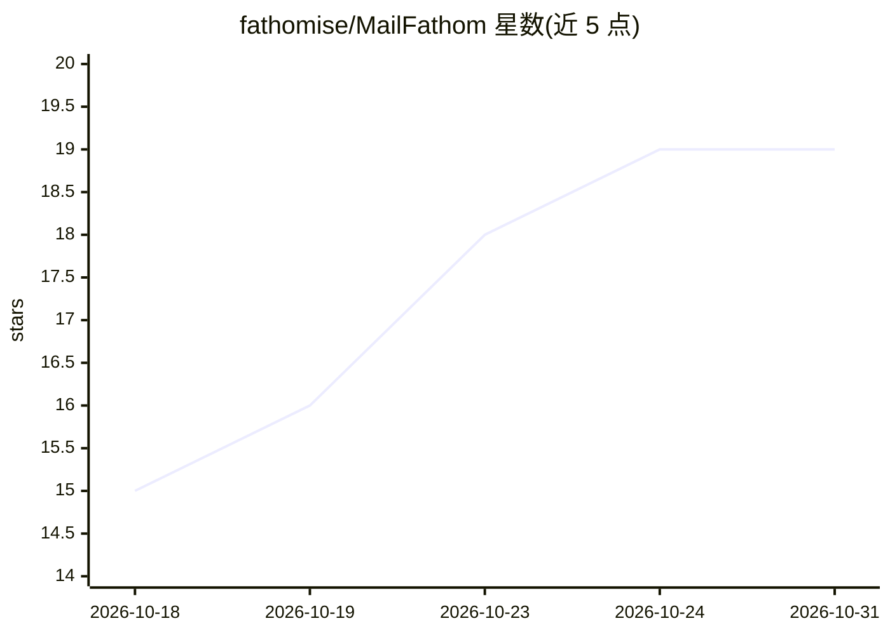

# fathomise/MailFathom

⭐ 19 · C# · AGPL-3.0 · 推送 2026-10-30 · [GitHub](https://github.com/fathomise/MailFathom) · [官网](https://fathomise.github.io/MailFathom/) · 组织维护

**自托管 IMAP 邮件库：同步到自有 PostgreSQL 并经 MCP 服务 AI agent**

把 IMAP 账户同步到用户自运行的 PostgreSQL，建立索引后以 Model Context Protocol 向 AI agent 提供 21 个工具：词法与嵌入检索、引用出处的问答、标记、草稿、发送及联系人簿。读取一律来自本地副本、不触碰邮件服务器；写入需逐账户逐凭据显式授权，默认全关，发送还受收件人策略与周期上限约束。凭据以引用（文件路径/systemd 凭据/环境变量）形式存放，配置文件不含密码。支持 Docker Compose、Podman Quadlet、Kubernetes（Helm）与 systemd 原生部署，多用户与凭据权限由数据库记录、mfctl 管理。1.0.0 前各版本可能不兼容。

## 筛选速览

| 维度 | 判定 | 备注 |
|---|---|---|
| AI 角色 | `ai-ecosystem` | LLM/agent 周边工具 |
| 许可风险 | `viral` | AGPL-3.0 |
| 部署形态 | `self-host` | docker 或自建部署 |
| 模型依赖 | — | README 未给出锁定关系 |
| 硬件要求 | — | 无带数字的原话,不猜 |
| 安装摩擦 | `low` | 无编译、无系统依赖或容器化 |
| 成熟度 | `idea` | |

## 能力要点

- IMAP 同步至自有 PostgreSQL，21 个 MCP 工具覆盖检索/问答/标记/草稿/发送/联系人
- 读取完全基于本地副本，写入需逐凭据显式授权且默认关闭
- 凭据只存引用（文件路径/systemd 凭据/环境变量），配置文件可安全备份
- 镜像经签名构建溯源，容器无 shell、只读根文件系统，Helm chart 满足 Restricted PSS

## 适用场景

- 让聊天客户端或 agent 通过 MCP 查询和检索我的邮件
- 多用户共用部署、按角色控制谁能读信或发信的企业邮件场景
- 在不把密码交给第三方 SaaS 的前提下为 AI 提供邮件访问

## 场景标签

`RAG` · 领域:知识与检索

## 证据(README 行号)

> L12: MailFathom synchronizes your IMAP accounts into a PostgreSQL database you run, indexes that copy, and serves it to 
> L60: |**Reading your mail**|`list_accounts`, `list_emails`, `search_emails` — ranked lexically, and by embedding similar

## 星数曲线

2026-10-18 15 → 2026-10-31 19（+4）

---
*卡片 v1 · prompt 1.4 · 生成 2026-10-28 · 置信度 high · 依据 README sha `9e43b05d4a34` · [字段定义](../../DATASET.md)*
