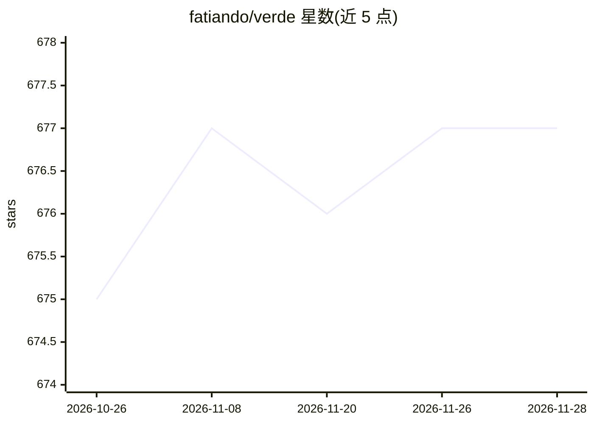

# fatiando/verde

⭐ 677 · Python · BSD-3-Clause · 推送 2026-11-16 · [GitHub](https://github.com/fatiando/verde) · [官网](https://www.fatiando.org/verde) · 组织维护

**面向地球科学的空间数据处理与网格化 Python 库**

Verde 是 Fatiando a Terra 项目下的 Python 库，用于处理地形、点云、测深、地球物理调查等空间数据，并在二维表面上插值（网格化）。其核心插值方法借鉴机器学习思路，接口仿照 scikit-learn，另提供趋势去除、分块/窗口运算、交叉验证等配套分析。支持标量与矢量数据网格化、笛卡尔与地理坐标系，并与 numpy/pandas/scikit-learn/xarray 集成。项目状态声明为稳定可用，但 main 分支正朝 v2.0 演进，含大量破坏性变更。

## 筛选速览

| 维度 | 判定 | 备注 |
|---|---|---|
| AI 角色 | `ai-native` | 本体是模型或模型工具 |
| 许可风险 | `permissive` | BSD-3-Clause |
| 部署形态 | `library` | 以包/库形式分发 |
| 模型依赖 | — | README 未给出锁定关系 |
| 硬件要求 | — | 无带数字的原话,不猜 |
| 安装摩擦 | `low` | 无编译、无系统依赖或容器化 |
| 成熟度 | — | 结构信号不足 |

## 能力要点

- 仿 scikit-learn 接口的插值/网格化实现
- 支持标量与矢量数据（如风速、GPS 速度场）网格化
- 支持笛卡尔与地理坐标
- 提供趋势去除、分块均值、交叉验证等配套处理

## 适用场景

- 将地形/测深点数据插值为规则网格
- 对地球物理调查数据做去趋势与分块预处理
- 用交叉验证评估网格化结果

## 场景标签

 · 领域:地球科学/科学计算

## 证据(README 行号)

> L26: **Verde** is a Python library for processing spatial data (topography, point
> L30: Our core interpolation methods are inspired by machine-learning.
> L31: As such, Verde implements an interface that is similar to the popular

## 星数曲线

2026-10-26 675 → 2026-11-28 677（+2）

---
*卡片 v1 · prompt 1.4 · 生成 2026-11-24 · 置信度 high · 依据 README sha `8a4ce7461c61` · [字段定义](../../DATASET.md)*
