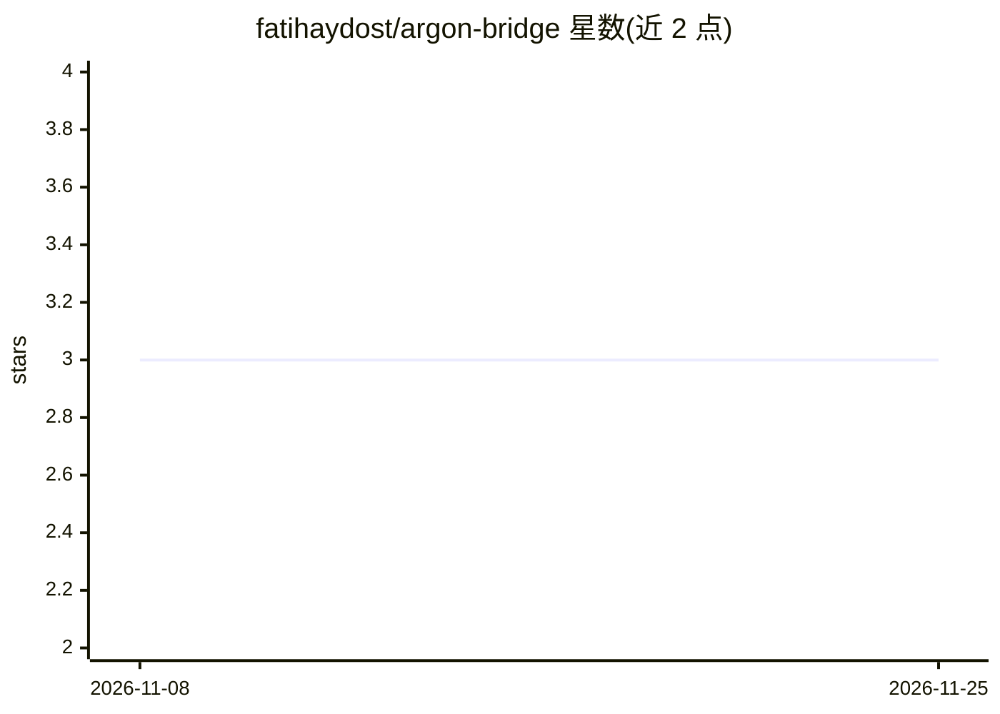

# fatihaydost/argon-bridge

⭐ 3 · Python · MIT · 推送 2026-10-29 · [GitHub](https://github.com/fatihaydost/argon-bridge) · 个人维护

**给 Claude Code 接入 Gemini 做计划/提交独立审查的插件**

以 Claude Code 插件形式提供的桥接工具：在计划确认或 git commit 时，把用户的原始消息、计划或 diff 以及只读仓库访问交给 Gemini 4 Argon（经 agy CLI），不共享 Claude 的会话历史，由 Claude 逐条核验发现并经用户批准。默认 standard 模式自动审查计划与提交，支持按需 review/ask 二次意见、托管模式下在隔离 git worktree 中分阶段执行编码任务，配置存于 ~/.config/argon-bridge/config.json。依赖 Claude Code、Python 3.9+ 与 git。

## 筛选速览

| 维度 | 判定 | 备注 |
|---|---|---|
| AI 角色 | `ai-native` | 本体是模型或模型工具 |
| 许可风险 | `permissive` | MIT |
| 部署形态 | `library` | 以包/库形式分发 |
| 模型依赖 | — | README 未给出锁定关系 |
| 硬件要求 | — | 无带数字的原话,不猜 |
| 安装摩擦 | `low` | 无编译、无系统依赖或容器化 |
| 成熟度 | — | 结构信号不足 |

## 能力要点

- 计划与提交的自动独立审查，提交在后台进行不阻塞（asyncRewake 唤醒）
- ask 命令并排展示 Argon 与 Claude 的独立观点，--findings 输出最多 15 条结构化发现
- 托管模式在隔离 git worktree 中分阶段执行，Claude 做阶段检查与合并门控
- 权限开关可阻止读取 .env、私钥与凭据目录

## 适用场景

- 长编码会话后让另一个模型以全新视角审查计划和提交
- 对架构或 schema 决策获取独立的第二意见
- 把写测试等阶段性任务托管给另一模型并保留人工合并审批

## 场景标签

`代码审查` · 领域:编码与开发

## 证据(README 行号)

> L6: **A Claude Code plugin that bridges Claude and Gemini 4 Argon: independent plan/commit review, second opinions, and 
> L10: `argon-bridge` gives **Gemini 4 Argon** (via the `agy` CLI) your raw messages, the plan or diff, and read-only acce

## 星数曲线

2026-11-08 3 → 2026-11-25 3（+0）

---
*卡片 v1 · prompt 1.4 · 生成 2026-11-22 · 置信度 low · 依据 README sha `2e4778fe29cc` · [字段定义](../../DATASET.md)*
