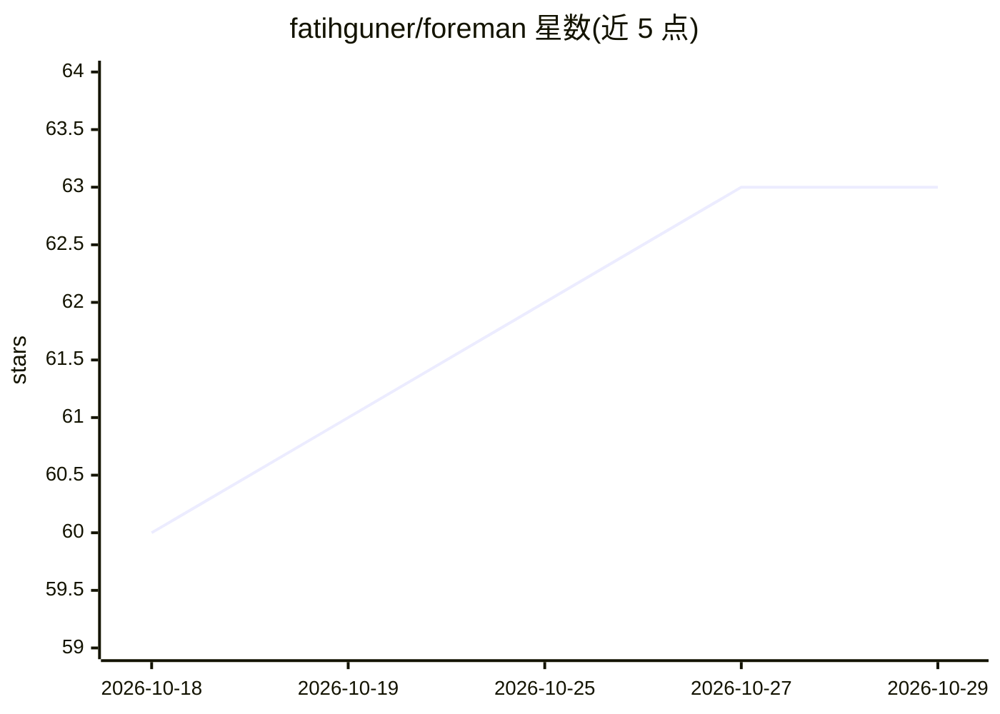

# fatihguner/foreman

⭐ 63 · JavaScript · MIT · 推送 2026-09-05 · [GitHub](https://github.com/fatihguner/foreman) · [官网](https://foreman.sh) · 个人维护

**面向创业者的 AI 战略顾问：158 个框架技能+行业包**

开源的创业者战略顾问插件包：以自然语言描述经营问题后，系统比对可能原因、选用 158 个商业框架之一应用到用户情境并产出交付物（48 个专业模板），另有 24 个诊断、21 个多步骤 playbook、9 个行业基准包和 10 个董事会对抗演练角色。以 `.claude/` 目录为单一事实来源，原生运行于 Claude Code，另提供 Codex 插件与 OpenClaw 适配（注册 10 个 agent 工具）。任务与偏好通过 5 层记忆持久化，跨会话保留。需 Node 22.19+，MIT 许可。

## 筛选速览

| 维度 | 判定 | 备注 |
|---|---|---|
| AI 角色 | `ai-native` | 本体是模型或模型工具 |
| 许可风险 | `permissive` | MIT |
| 部署形态 | `library` | 以包/库形式分发 |
| 模型依赖 | locked-api |  |
| 硬件要求 | — | 无带数字的原话,不猜 |
| 安装摩擦 | `low` | 无编译、无系统依赖或容器化 |
| 成熟度 | — | 结构信号不足 |

## 能力要点

- 158 个技能覆盖 12 类（框架/领导力/博弈论/斯多葛等）
- 9 个行业包提供 SaaS/Marketplace/Fintech 等行业基准
- 5 层记忆（Identity→Session）跨会话持久化创始人状态
- 多平台：Claude Code 原生、Codex 插件、OpenClaw 原生插件

## 适用场景

- 用自然语言诊断营收下滑等经营问题并套用框架分析
- 董事会演讲前与 10 个对抗角色演练并获五维评分
- 按 SaaS/Fintech 等行业基准做融资与增长分析
- 跟踪战略建议的执行进度（六状态+每周签到）

## 场景标签

`AI 助手` · 领域:对话与助手

## 证据(README 行号)

> L24: You describe your problem in plain language. Foreman compares plausible causes, selects a framework, applies it to 
> L88: |**Claude Code**|Native|`.claude/` directory: skills, commands, hooks, agents, memory|

## 星数曲线

2026-10-18 60 → 2026-10-29 63（+3）

---
*卡片 v1 · prompt 1.4 · 生成 2026-10-24 · 置信度 high · 依据 README sha `4aaa99460d08` · [字段定义](../../DATASET.md)*
