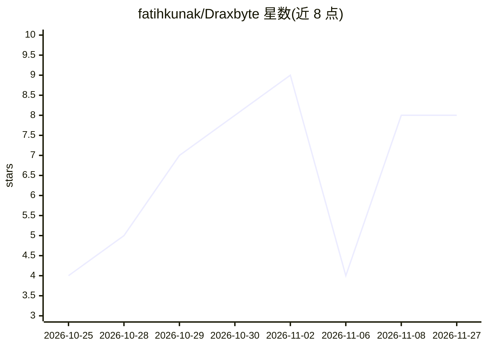

# fatihkunak/Draxbyte

⭐ 8 · Rust · MIT · 推送 2026-11-03 · [GitHub](https://github.com/fatihkunak/Draxbyte) · [官网](https://github.com/fatihkunak/Draxbyte/wiki) · 个人维护

**Windows/macOS 本地优先磁盘清理工具，带可选 AI 顾问**

基于 Rust + egui 的桌面磁盘扫描与清理工具，单文件约 16-20 MB，可离线运行。扫描后按安全/注意/删除三级着色标注候选文件，未经用户确认不删除任何内容，默认删除进回收站可撤销。功能包括并行扫描、磁盘 treemap 地图、SHA-256 重复文件检测、程序卸载与注册表备份、启动项管理、Docker 清理与一键全量优化流程。AI 部分默认关闭，开启后提供扫描结果问答与 AI 报告，支持 14 个提供方与故障转移链，仅给建议不执行删除。

## 筛选速览

| 维度 | 判定 | 备注 |
|---|---|---|
| AI 角色 | `ai-enhanced` | 去掉 AI 部分产品仍成立 |
| 许可风险 | `permissive` | MIT |
| 部署形态 | `desktop` | 安装包/桌面程序 |
| 模型依赖 | local-ok | 支持本地模型 |
| 硬件要求 | — | 无带数字的原话,不猜 |
| 安装摩擦 | `medium` | 含编译或系统依赖之一 |
| 成熟度 | — | 结构信号不足 |

## 能力要点

- 三级颜色分类与逐项理由说明，删除前二次校验
- 重复文件检测：大小→首尾 64 KB→完整 SHA-256 分层比对
- 可选 AI 顾问：14 个提供方、故障转移链、每日 token 限额、结果本地缓存
- CLI 命令 draxbyte scan/clean/optimize，默认干运行

## 适用场景

- 定期清理 home 目录与临时文件夹里的旧日志和缓存
- 用磁盘地图找出占用空间最大的目录
- 批量卸载程序并清理残留（AppData、注册表、服务）
- 让 AI 顾问解读扫描结果并给出清理建议

## 场景标签

 · 领域:系统工具/磁盘清理

## 证据(README 行号)

> L7:  Local-first disk scanner and cleaner. One small binary, works offline, never deletes anything without your approval
> L30: - **Yapay zekâ isteğe bağlı.** Varsayılan **kapalı**; kapalıyken tek bir ağ isteği bile atılmaz. Açarsan her
> L45: - 🤖 **İsteğe bağlı AI** — 14 sağlayıcı (Ollama ve LM Studio yerelde ücretsiz), modeller otomatik getirilir, önbelle

## 星数曲线

2026-10-25 4 → 2026-11-27 8（+4）

---
*卡片 v1 · prompt 1.4 · 生成 2026-11-20 · 置信度 high · 依据 README sha `085b92e41bed` · [字段定义](../../DATASET.md)*
