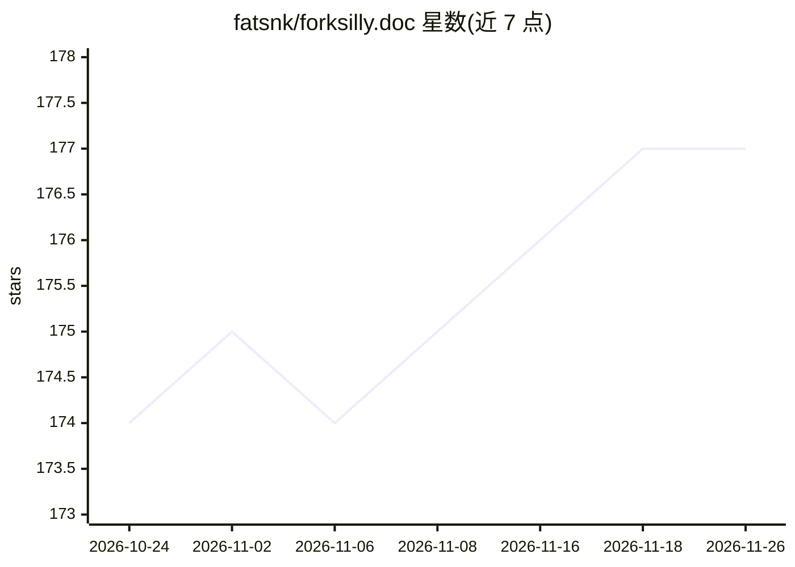

# fatsnk/forksilly.doc

⭐ 177 · Kotlin · AGPL-3.0 · 推送 2026-11-12 · [GitHub](https://github.com/fatsnk/forksilly.doc) · [官网](https://forksilly.qzz.io) · 个人维护 · 中文 README

**兼容酒馆角色卡/世界书的安卓 LLM 聊天与文生图客户端**

React Native/Expo 构建的安卓应用，面向有 SillyTavern 使用经验的用户。兼容 SillyTavern V2 角色卡、世界书、正则、预设与聊天记录的导入导出；通过 API 模板引擎接入多种 API 格式，可添加远程 MCP 服务；聊天中触发 Stable Diffusion、OpenAI 兼容格式、NovelAI 等文生图；可选接入嵌入模型生成记忆并存入本地向量数据库。不支持 TTS，应用不自动截断上下文。APK 于 releases 发布，自行打包需配置 Android 与 Java 开发环境。

## 筛选速览

| 维度 | 判定 | 备注 |
|---|---|---|
| AI 角色 | `ai-native` | 本体是模型或模型工具 |
| 许可风险 | `viral` | AGPL-3.0 |
| 部署形态 | `library` | 以包/库形式分发 |
| 模型依赖 | — | README 未给出锁定关系 |
| 硬件要求 | — | 无带数字的原话,不猜 |
| 安装摩擦 | `low` | 无编译、无系统依赖或容器化 |
| 成熟度 | — | 结构信号不足 |

## 能力要点

- 兼容 SillyTavern V2 角色卡/世界书/正则/预设/聊天记录的双向导入导出
- API 模板引擎兼容任意格式 API，另支持远程 MCP 服务接入
- 聊天内文生图：pollinations、OpenAI 兼容格式、Stable Diffusion、NovelAI
- 内置存储/备份管理与可选本地向量数据库记忆功能

## 适用场景

- 在手机上导入并使用 SillyTavern 角色卡与世界书聊天
- 在对话中直接调用 Stable Diffusion 生成插图
- 为聊天角色建立本地记忆与知识库

## 场景标签

`聊天机器人` `图像生成` `Agent 记忆` · 领域:Agent 开发

## 证据(README 行号)

> L46: ForkSilly: *一个react native/expo项目，主要用于Android。适用于对sillytavern有一定使用经验的用户* ~~*小孩子不懂事，写着玩的🤕* *中文名*：*“傻叉”*（~~ 由于手机端sill
> L57: + 兼容sillytavern V2角色卡、世界书、正则、预设、聊天记录，可以随时导入导出。（兼容性指引）
> L187: forksilly项目是一个开源的通用大语言模型（LLM）前端工具，仅提供技术框架和接口集成功能。

## 星数曲线

2026-10-24 174 → 2026-11-26 177（+3）

---
*卡片 v1 · prompt 1.4 · 生成 2026-11-26 · 置信度 high · 依据 README sha `8b2ef128e311` · [字段定义](../../DATASET.md)*
