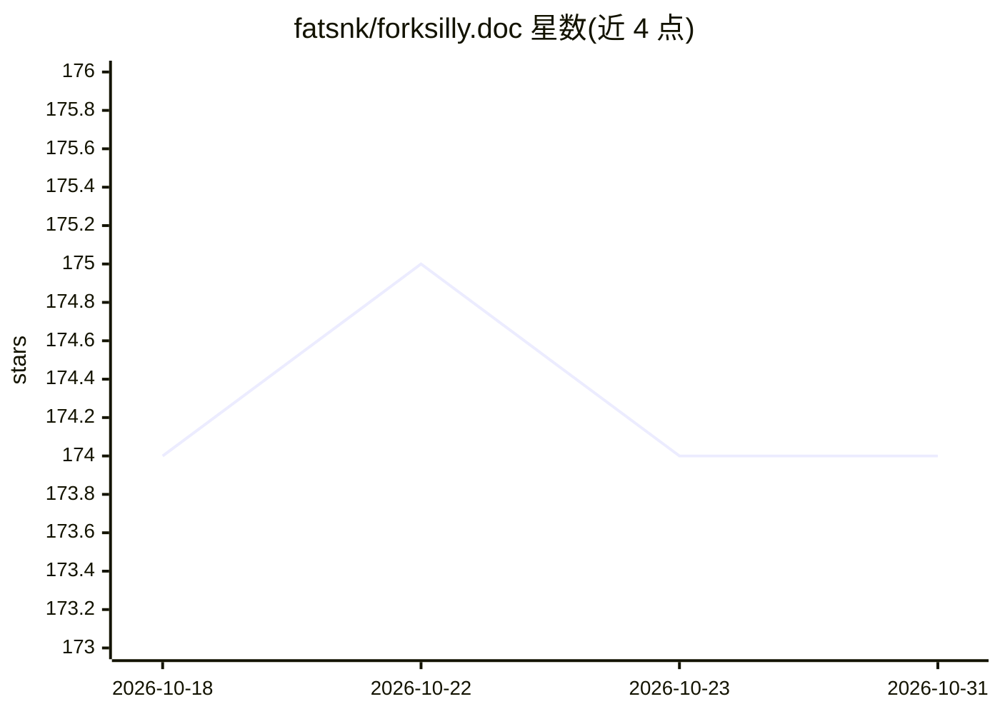

# fatsnk/forksilly.doc

⭐ 174 · Kotlin · AGPL-3.0 · 推送 2026-10-20 · [GitHub](https://github.com/fatsnk/forksilly.doc) · [官网](https://forksilly.qzz.io) · 个人维护 · 中文 README

**兼容酒馆角色卡的安卓 LLM 聊天前端，兼作 SD 文生图客户端**

React Native/Expo 编写的 Android 移动端应用，定位为 SillyTavern（酒馆）的移动端替代使用方案：兼容 V2 角色卡、世界书、正则、预设与聊天记录的导入导出。通过 API 模板引擎适配任意 API 格式，支持远程 MCP 服务、记忆/知识库（硅基流动与 Gemini 嵌入模型）、实验性宏引擎、占位符与斜杠命令。文生图方面支持 Stable Diffusion、openai 兼容格式与 NovelAI API。限制：不支持 TTS、不兼容前端/MVU 变量/ejs；源码与 APK 从 releases 发布，本仓库为文档仓库。AGPL-3.0 授权，不提供闭源许可。

## 筛选速览

| 维度 | 判定 | 备注 |
|---|---|---|
| AI 角色 | `ai-native` | 本体是模型或模型工具 |
| 许可风险 | `viral` | AGPL-3.0 |
| 部署形态 | `library` | 以包/库形式分发 |
| 模型依赖 | — | README 未给出锁定关系 |
| 硬件要求 | — | 无带数字的原话,不猜 |
| 安装摩擦 | `low` | 无编译、无系统依赖或容器化 |
| 成熟度 | — | 结构信号不足 |

## 能力要点

- 兼容酒馆 V2 角色卡、世界书、正则、预设、聊天记录的导入导出
- API 模板引擎适配任意 API 格式，支持远程 MCP 服务
- 聊天内文生图：Stable Diffusion / openai 兼容格式 / NovelAI API
- 基于嵌入模型的记忆与知识库，保存到本地向量数据库

## 适用场景

- 在手机上继续使用我的酒馆角色卡和预设聊天
- 在对话中让 AI 生成插图（SD/pollinations/NovelAI）
- 通过模板接入 DeepSeek、Gemini、Claude 等不同 API 格式

## 场景标签

`聊天机器人` `图像生成` · 领域:对话与助手

## 证据(README 行号)

> L46: ForkSilly: *一个react native/expo项目，主要用于Android。适用于对sillytavern有一定使用经验的用户* ~~*小孩子不懂事，写着玩的🤕* *中文名*：*“傻叉”*（~~ 由于手机端sill
> L57: + 兼容sillytavern V2角色卡、世界书、正则、预设、聊天记录，可以随时导入导出。（兼容性指引）

## 星数曲线

2026-10-18 174 → 2026-10-31 174（+0）

---
*卡片 v1 · prompt 1.4 · 生成 2026-10-22 · 置信度 high · 依据 README sha `7c6c0737dd0c` · [字段定义](../../DATASET.md)*
