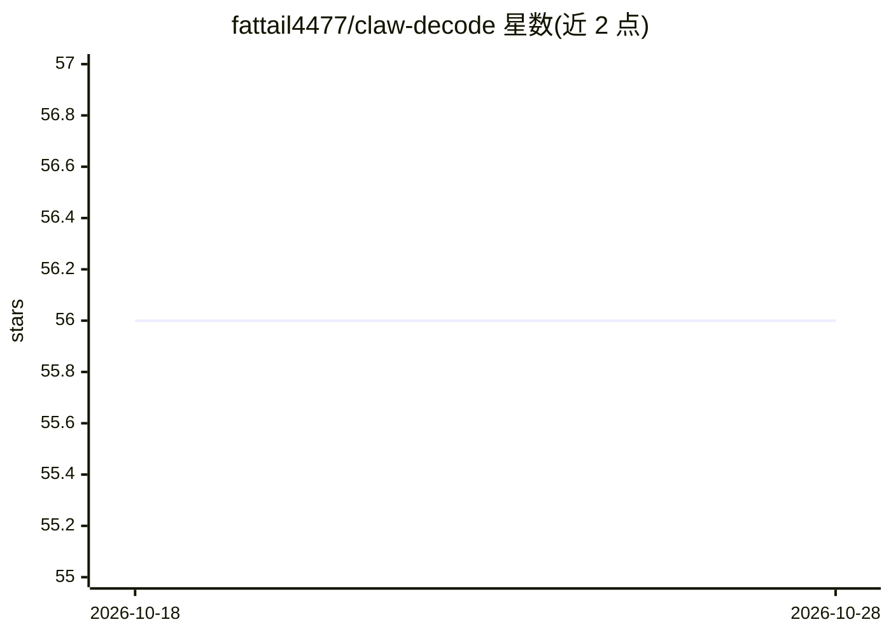

# fattail4477/claw-decode

⭐ 56 · TypeScript · MIT · 推送 2026-04-01 · [GitHub](https://github.com/fattail4477/claw-decode) · [官网](https://www.clawdecode.net) · 个人维护

**Claude Code 泄露源码的分析文档库：隐藏功能与43个工具定义**

对 Claude Code 约 51.2 万行泄露源码的纯分析文档仓库，不含源码本身。内容含重构的完整系统提示词（内部/外部构建差异）、43 个工具定义与架构解析、7 篇隐藏功能深潜（虚拟宠物、Dream Mode、KAIROS、多 Agent 协作等）、Mermaid 架构图与 5 条可复用 Agent 设计模式。面向构建 AI Agent 的开发者和研究者，以静态 Markdown 文档形式提供，无需安装，无可运行代码。

## 筛选速览

| 维度 | 判定 | 备注 |
|---|---|---|
| AI 角色 | `ai-knowledge` | 知识聚合/清单类 |
| 许可风险 | `permissive` | MIT |
| 部署形态 | `None` |  |
| 模型依赖 | — | README 未给出锁定关系 |
| 硬件要求 | — | 无带数字的原话,不猜 |
| 安装摩擦 | `low` | 无编译、无系统依赖或容器化 |
| 成熟度 | — | 结构信号不足 |

## 能力要点

- 重构完整系统提示词并对比内部/外部构建差异
- 43 个工具的提示词与 schema 提取（40 个文件）
- 7 篇隐藏功能深潜与 Mermaid 架构图
- 5 条可复用的 Agent 架构设计模式

## 适用场景

- 构建 AI Agent 时参考 Claude Code 的架构模式
- 查阅 Claude Code 的工具定义与系统提示词设计
- 了解未发布功能与特性开关清单

## 场景标签

`提示工程` · 领域:Agent 开发

## 证据(README 行号)

> L5:  Claude Code's source leaked. We read all 512,000 lines. Here's what Anthropic was hiding.
> L83: **51 files. Zero source code. Pure analysis.**

## 星数曲线

2026-10-18 56 → 2026-10-28 56（+0）

---
*卡片 v1 · prompt 1.4 · 生成 2026-10-24 · 置信度 high · 依据 README sha `5ed656bd993f` · [字段定义](../../DATASET.md)*
