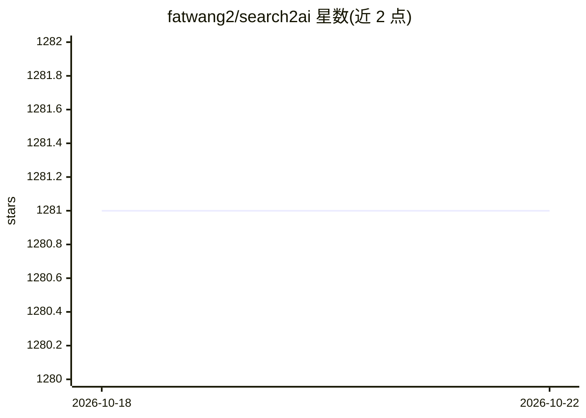

# fatwang2/search2ai

⭐ 1,281 · TypeScript · MIT · 推送 2026-09-03 · [GitHub](https://github.com/fatwang2/search2ai) · [官网](https://sum4all.site/telegram) · 个人维护 · 中文 README

**给 AI Agent 用的自托管搜索网关，多搜索源自动 fallback**

自托管的 Perplexity 兼容搜索 API 网关，聚合 Search1API、Tavily、Brave、Exa、Serper、Google、SearXNG 等服务，按 fallback 链在限流、超时、报错时自动切换下一家并记录 warnings。提供 search/news/crawl 三种能力，可作 npm 库 import、HTTP 服务、MCP server 或挂入 Hono 应用，兼容 Claude、Cursor 等客户端；需自带各 provider 的 API key。另保留 0.2.x 代理模式，可为不联网客户端注入搜索工具。

## 筛选速览

| 维度 | 判定 | 备注 |
|---|---|---|
| AI 角色 | `ai-ecosystem` | LLM/agent 周边工具 |
| 许可风险 | `permissive` | MIT |
| 部署形态 | `self-host` | docker 或自建部署 |
| 模型依赖 | — | README 未给出锁定关系 |
| 硬件要求 | — | 无带数字的原话,不猜 |
| 安装摩擦 | `low` | 无编译、无系统依赖或容器化 |
| 成熟度 | — | 结构信号不足 |

## 能力要点

- 统一 title/url/snippet/date schema，换 provider 不改代码
- 限流/超时/报错自动切换下一家 provider 并返回 warnings
- 支持 Node、Cloudflare Workers、Bun、Docker 同一份代码部署
- 可作为 MCP server 提供 search/news/crawl 三个工具

## 适用场景

- 给 Claude、Cursor 等 AI 客户端接入联网搜索能力
- 自建一个高可用的搜索 API，避免单一搜索服务限流中断
- 通过 MCP 或库调用为 AI Agent 提供网页抓取与新闻检索

## 场景标签

`网页抓取` · 领域:效率与自动化

## 证据(README 行号)

> L5: 给 AI Agent 用的自托管搜索网关。一个 Perplexity 兼容的搜索 API，背后接 Search1API、Tavily、Brave、Exa、Serper、SerpApi、Google、SearXNG 等多家服务，一家挂
> L10: - **库优先**：核心零框架依赖，HTTP 与 MCP 只是薄壳；TypeScript + Hono，Node、Cloudflare Workers、Bun、Docker 同一份代码

## 星数曲线

2026-10-18 1,281 → 2026-10-22 1,281（+0）

---
*卡片 v1 · prompt 1.4 · 生成 2026-10-21 · 置信度 high · 依据 README sha `f2d94d4e4b50` · [字段定义](../../DATASET.md)*
