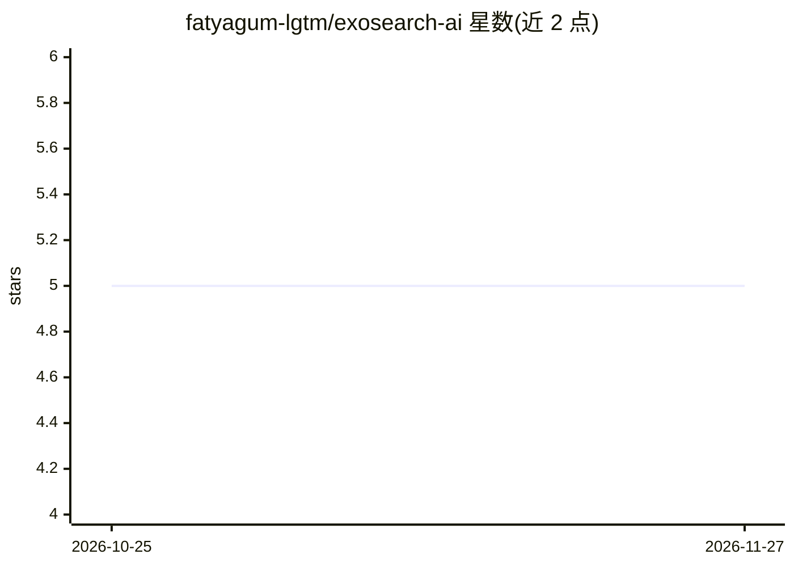

# fatyagum-lgtm/exosearch-ai

⭐ 5 · Python · MIT · 推送 2026-10-15 · [GitHub](https://github.com/fatyagum-lgtm/exosearch-ai) · 组织维护

**面向天文学者的 TESS 系外行星候选分类与排序 ML 工具**

基于 NASA Exoplanet Archive TOI 目录数据的科研机器学习项目：下载带 SHA-256 溯源记录的目录快照，校验 schema 与标签泄露，按宿主恒星 TIC ID 分组切分，训练 Logistic Regression 与 XGBoost 两个分类器，用验证集 average precision 选优，仅对未定论的 PC/APC 候选打分并导出排序 CSV 供天文学家复核，另生成离线交互式 dashboard。明确声明不做凌星检测、不是行星确认，缺乏前瞻性外部验证。

## 筛选速览

| 维度 | 判定 | 备注 |
|---|---|---|
| AI 角色 | `ai-native` | 本体是模型或模型工具 |
| 许可风险 | `permissive` | MIT |
| 部署形态 | `library` | 以包/库形式分发 |
| 模型依赖 | — | README 未给出锁定关系 |
| 硬件要求 | — | 无带数字的原话,不猜 |
| 安装摩擦 | `low` | 无编译、无系统依赖或容器化 |
| 成熟度 | — | 结构信号不足 |

## 能力要点

- TIC-disjoint 切分防止宿主恒星标签泄露
- 下载 NASA TOI 快照并记录 SHA-256、时间与 provenance
- 输出 precision/recall/F1/AP/ROC-AUC/Brier 全套指标与 PR/ROC 曲线
- 离线交互式 dashboard 与排序 CSV 导出

## 适用场景

- 对未定论 TESS 目的候选进行后续观测优先级排序
- 复现带防泄露切分的目录分类实验
- 教学演示可复现科研 ML 流水线

## 场景标签

`科研工具` · 领域:学习与行业

## 证据(README 行号)

> L9: ExoSearch AI studies whether catalog measurements can help **prioritize unresolved TESS Objects of Interest (TOIs)**
> L19: - Trains Logistic Regression and XGBoost with imputation fitted only to training data.
> L23: - Scores only unresolved `PC`/`APC` candidate records and exports a ranked CSV for astronomer review.

## 星数曲线

2026-10-25 5 → 2026-11-27 5（+0）

---
*卡片 v1 · prompt 1.4 · 生成 2026-11-21 · 置信度 high · 依据 README sha `6755eb649fb2` · [字段定义](../../DATASET.md)*
