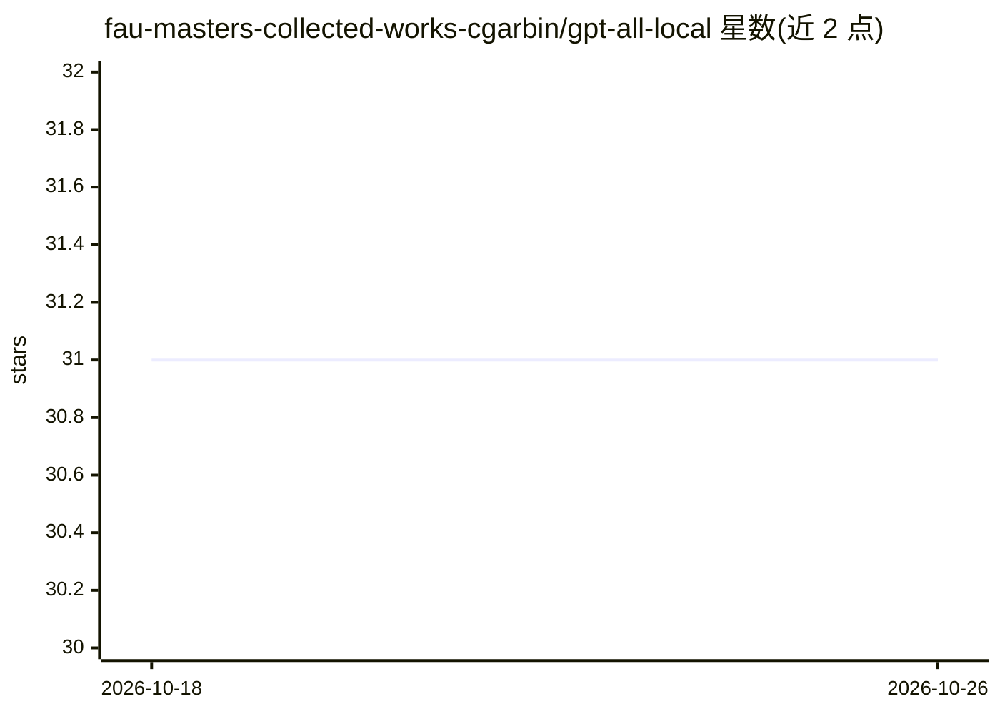

# fau-masters-collected-works-cgarbin/gpt-all-local

⭐ 31 · Python · 推送 2026-01-15 · [GitHub](https://github.com/fau-masters-collected-works-cgarbin/gpt-all-local) · 个人维护

**本地化 RAG 学习示例：用本机 LLM 问答自己的文档**

一个以学习为目的实现的"与私有数据对话"示例项目，基于早期 privateGPT 重新实现 RAG 全流程：文档切块、向量嵌入、向量库持久化、相似度检索与 LLM 生成，所有环节（嵌入模型、LLM、向量库）均在本地运行。提供命令行与 Streamlit 两种使用方式，模块化 pipeline 可独立替换 LLM 或向量库。限制：为在本地机器上以合理时间运行，使用小模型与小嵌入维度，chunk 大小为硬编码。PDF 解析需另装 poppler 与 tesseract。

## 筛选速览

| 维度 | 判定 | 备注 |
|---|---|---|
| AI 角色 | `ai-native` | 本体是模型或模型工具 |
| 许可风险 | `none` | — |
| 部署形态 | `library` | 以包/库形式分发 |
| 模型依赖 | — | README 未给出锁定关系 |
| 硬件要求 | — | 无带数字的原话,不猜 |
| 安装摩擦 | `low` | 无编译、无系统依赖或容器化 |
| 成熟度 | — | 结构信号不足 |

## 能力要点

- ingest/retrieve/generate 三步模块化 RAG pipeline，组件可独立替换
- 嵌入模型、LLM、向量数据库全部本地运行
- 提供命令行（--verbose 日志）与 Streamlit 两种界面
- 首次运行自动下载嵌入模型，向量库持久化避免重复计算

## 适用场景

- 在本机对 PDF/Word/文本等私有文档做问答
- 学习理解 RAG 各环节（切块、嵌入、检索、生成）的实现
- 作为可改造的 RAG 代码基础，替换其中的 LLM 或向量库

## 场景标签

`RAG` · 领域:知识与检索

## 证据(README 行号)

> L3: This project is a learning exercise on using large language models (LLMs) to retrieve information from private data,
> L5: This method of combining LLMs and private data is known as **retrieval-augmented generation** (RAG). It was introduc

## 星数曲线

2026-10-18 31 → 2026-10-26 31（+0）

---
*卡片 v1 · prompt 1.4 · 生成 2026-10-26 · 置信度 high · 依据 README sha `64af9d42c1ad` · [字段定义](../../DATASET.md)*
