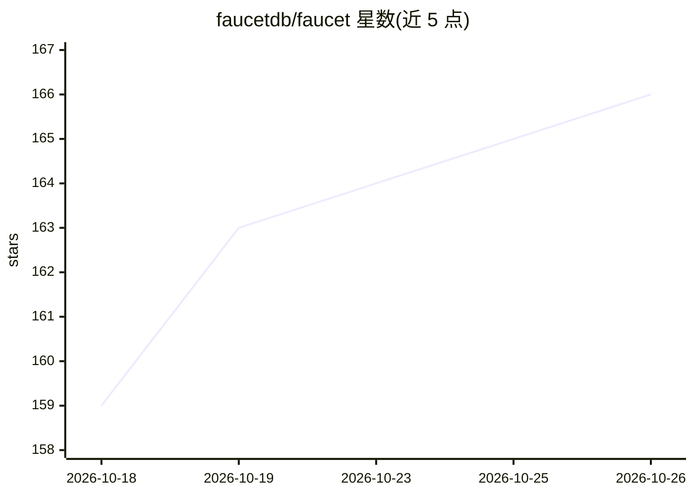

# faucetdb/faucet

⭐ 166 · Go · MIT · 推送 2026-10-18 · [GitHub](https://github.com/faucetdb/faucet) · [官网](https://www.faucetdb.ai) · 组织维护

**把任意 SQL 数据库变成带 RBAC 的 REST API 和 MCP 服务器**

单个 Go 二进制的自托管数据库网关：连接 PostgreSQL、MySQL、MariaDB、SQL Server、Oracle、Snowflake 或 SQLite，运行时内省 schema 并生成 CRUD REST 端点、OpenAPI 3.1 文档与 MCP 工具，无需代码生成或 ORM。安全机制包括 API key（SHA-256 哈希）、JWT 管理会话与按表按动词的 RBAC；内置管理 UI，配置存于本地 SQLite。内置 MCP 服务器供 Claude、Cursor、VS Code 等 AI agent 以同一套角色规则查询数据库。行级安全过滤的查询端执行尚未实现（planned）。

## 筛选速览

| 维度 | 判定 | 备注 |
|---|---|---|
| AI 角色 | `ai-ecosystem` | LLM/agent 周边工具 |
| 许可风险 | `permissive` | MIT |
| 部署形态 | `desktop` | 安装包/桌面程序 |
| 模型依赖 | locked-api |  |
| 硬件要求 | — | 无带数字的原话,不猜 |
| 安装摩擦 | `low` | 无编译、无系统依赖或容器化 |
| 成熟度 | — | 结构信号不足 |

## 能力要点

- 运行时从数据库 schema 生成 REST 端点、OpenAPI 3.1 与 MCP 工具，无代码生成
- 单二进制、零外部依赖，跨 Linux/macOS/Windows，配置存本地 SQLite
- API key/JWT 认证与按表按动词的 RBAC，MCP 与 REST 共用同一权限规则
- 内置 8 工具+2 资源的 MCP 服务器（Streamable HTTP 与 stdio）

## 适用场景

- 给前端应用即时生成 CRUD 后端，跳过手写 API
- 让 Claude、Cursor 等 AI agent 以受控权限读写数据库
- 为 SQL Server 2012、MySQL 5.7 等旧数据库加 REST API 层
- 一个实例聚合多种数据库，通过统一 API 查询

## 场景标签

 · 领域:数据库/API 基础设施

## 证据(README 行号)

> L28: Faucet is a **database-to-REST-API gateway** — a lightweight, self-hosted server that connects to your SQL database
> L87: ### AI Agent Integration (MCP)
> L161: Faucet includes a built-in Model Context Protocol (MCP) server, so AI agents such as Claude, Cursor, VS Code Copil

## 星数曲线

2026-10-18 159 → 2026-10-26 166（+7）

---
*卡片 v1 · prompt 1.4 · 生成 2026-10-23 · 置信度 high · 依据 README sha `252ed04f2d31` · [字段定义](../../DATASET.md)*
