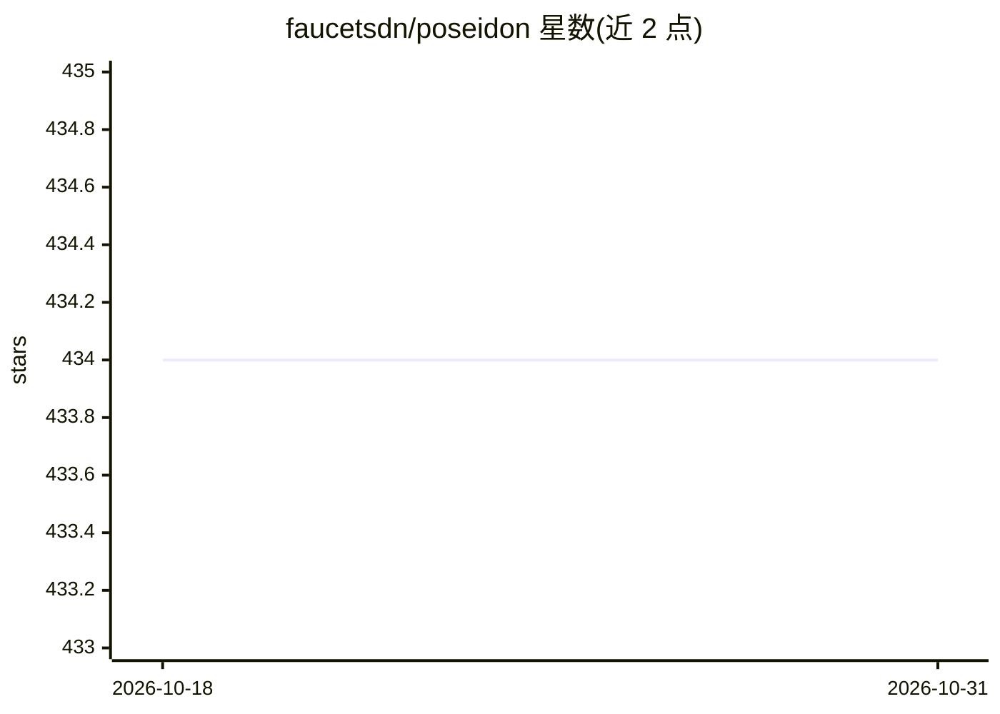

# faucetsdn/poseidon

⭐ 434 · Python · Apache-2.0 · 推送 2026-01-06 · [GitHub](https://github.com/faucetsdn/poseidon) · 组织维护

**基于 SDN 与机器学习的网络设备识别与态势感知工具**

由 IQT Labs（Cyber Reboot 与 Lab41）发起的 Python 应用：利用软件定义网络自动捕获网络流量，从 IP 头数据提取特征，经训练模型对网络中节点的设备类型进行分类与预测，并传达结果、支持后续动作。需配合 Faucet SDN 控制器、Docker 与 docker-compose 部署，也支持仅用 pcap 文件运行部分功能。定位之一是承载多种机器学习技术的 harness，用于扩展更多用例。

## 筛选速览

| 维度 | 判定 | 备注 |
|---|---|---|
| AI 角色 | `ai-native` | 本体是模型或模型工具 |
| 许可风险 | `permissive` | Apache-2.0 |
| 部署形态 | `None` |  |
| 模型依赖 | — | README 未给出锁定关系 |
| 硬件要求 | — | 无带数字的原话,不猜 |
| 安装摩擦 | `low` | 无编译、无系统依赖或容器化 |
| 成熟度 | — | 结构信号不足 |

## 能力要点

- SDN 驱动自动捕获流量并提取特征，用训练模型分类设备类型
- 可作为承载其他机器学习技术的 harness
- 无 SDN 时可基于 pcap 文件使用部分功能
- 支持 Faucet stacking 分布式交换镜像流量

## 适用场景

- 企业网络盘点并识别接入设备的类型
- 网络监控与取证中定位异常节点行为
- 作为框架接入自定义机器学习模型做流量分析

## 场景标签

`网络安全` · 领域:学习与行业

## 证据(README 行号)

> L12: Poseidon began as a joint effort between two of the IQT Labs: Cyber Reboot and Lab41. The project's goal is to expl
> L18: The Poseidon project originally began as an experiment to test the merits of leveraging SDN and machine learning te

## 星数曲线

2026-10-18 434 → 2026-10-31 434（+0）

---
*卡片 v1 · prompt 1.4 · 生成 2026-10-21 · 置信度 high · 依据 README sha `6d268be087bc` · [字段定义](../../DATASET.md)*
