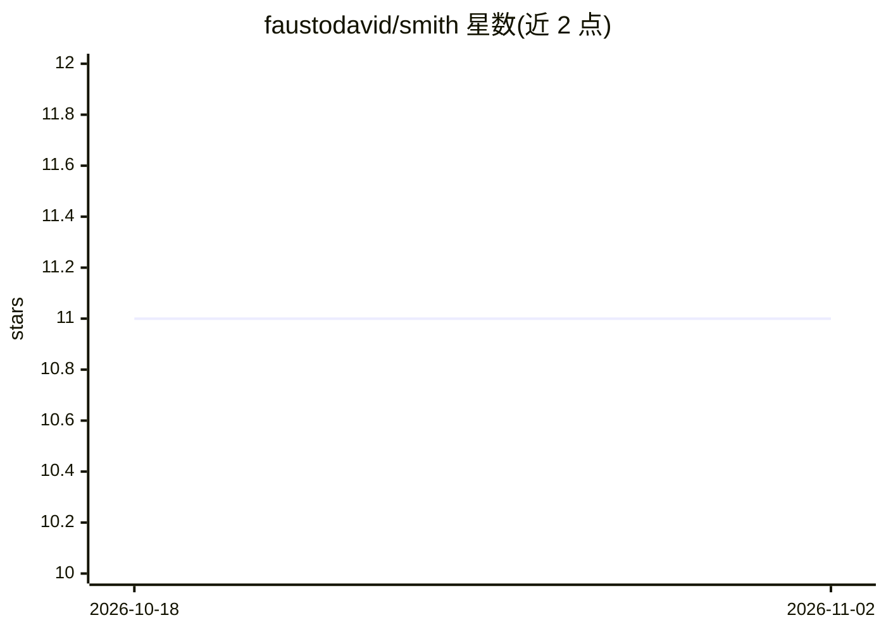

# faustodavid/smith

⭐ 11 · Python · MIT · 推送 2026-10-20 · [GitHub](https://github.com/faustodavid/smith) · 个人维护

**面向 AI agent 的跨仓库只读代码调查 CLI**

供 AI 编程代理使用的命令行工具：在 GitHub、GitLab、Azure DevOps、YouTrack 四个平台上执行代码搜索、正则 grep、PR 检查、CI/CD 日志扫描与工作项查询，无需克隆仓库、无需写权限。统一动词接口（code search/code grep/prs/pipelines/stories）跨平台一致；返回面向 LLM 上下文预算的片段而非完整文件。config init 会安装 agent skill 到 ~/.agents/skills/smith。需 Python 3.12+，安装器依赖 uv、git、ripgrep。项目自述为 alpha 状态，命令细节可能变化。

## 筛选速览

| 维度 | 判定 | 备注 |
|---|---|---|
| AI 角色 | `ai-ecosystem` | LLM/agent 周边工具 |
| 许可风险 | `permissive` | MIT |
| 部署形态 | `None` |  |
| 模型依赖 | — | README 未给出锁定关系 |
| 硬件要求 | — | 无带数字的原话,不猜 |
| 安装摩擦 | `low` | 无编译、无系统依赖或容器化 |
| 成熟度 | `idea` | |

## 能力要点

- 四平台（GitHub/GitLab/Azure DevOps/YouTrack）统一的只读调查命令集
- 无 create/update/approve/comment 等写命令，按契约只读
- token 存储于环境变量、OS 密钥链或 provider CLI 登录，非托管代理
- smith config init 自动安装并维护 agent skill

## 适用场景

- 让 AI agent 跨多个代码托管平台回答 CI 失败原因或依赖使用范围
- 跨仓库定位配置项定义、检索 PR 讨论与 issue 上下文
- 在不克隆仓库、无写权限的环境下做代码证据调查

## 场景标签

 · 领域:开发者工具/AI agent 基础设施

## 证据(README 行号)

> L3: **Let your AI coding agent investigate code anywhere — without cloning, and without write access.**
> L84: `smith config init` also installs the **Smith agent skill** to
> L235: Smith is alpha software. The goal is a stable, read-only investigation contract

## 星数曲线

2026-10-18 11 → 2026-11-02 11（+0）

---
*卡片 v1 · prompt 1.4 · 生成 2026-11-02 · 置信度 high · 依据 README sha `f56332913c44` · [字段定义](../../DATASET.md)*
