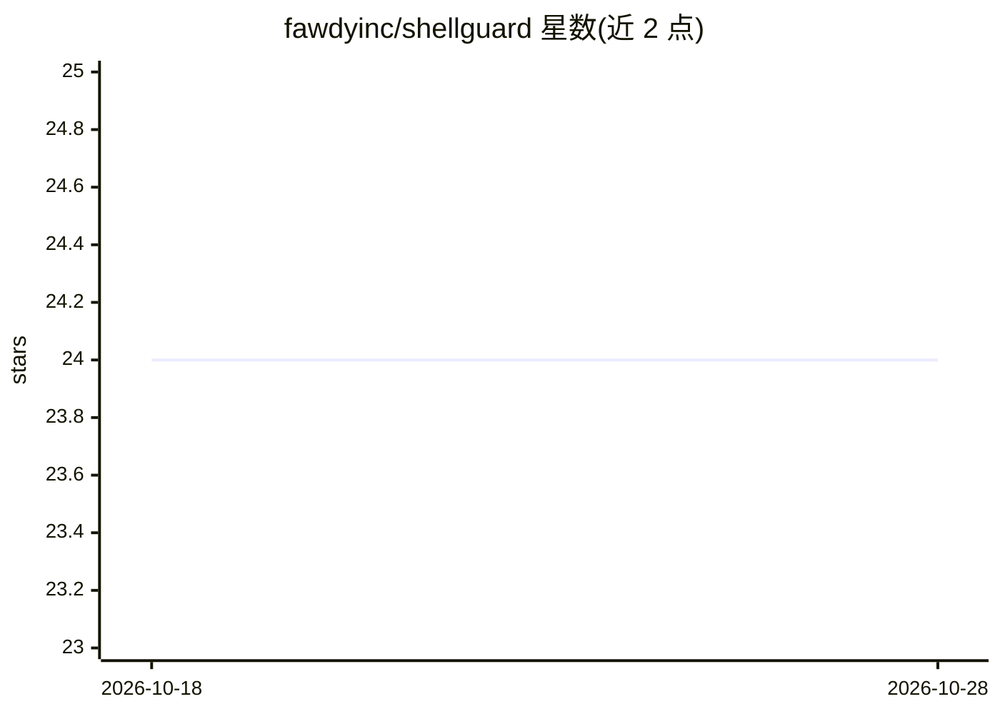

# fawdyinc/shellguard

⭐ 25 · Go · Apache-2.0 · 推送 2026-08-21 · [GitHub](https://github.com/fawdyinc/shellguard) · 组织维护

**给 LLM agent 提供 SSH 只读 shell 访问的 MCP server**

以 stdio MCP server 形式运行，向 LLM agent 暴露 6 个工具，通过 SSH 连接远程服务器执行经校验的 bash 命令，用于诊断、日志检查与故障排查。每条命令经 AST 解析、白名单校验（默认拒绝）与参数重构后执行，拦截破坏性操作并给出替代建议。支持原生 Go SSH 库与系统 ssh 二进制两种模式、多种主机密钥验证策略，可为远端部署 rg/jq/yq 工具，也可作为 Go 库使用。由 Fawdy 团队维护，可与其服务器调查产品配合。

## 筛选速览

| 维度 | 判定 | 备注 |
|---|---|---|
| AI 角色 | `ai-ecosystem` | LLM/agent 周边工具 |
| 许可风险 | `permissive` | Apache-2.0 |
| 部署形态 | `library` | 以包/库形式分发 |
| 模型依赖 | — | README 未给出锁定关系 |
| 硬件要求 | — | 无带数字的原话,不猜 |
| 安装摩擦 | `low` | 无编译、无系统依赖或容器化 |
| 成熟度 | — | 结构信号不足 |

## 能力要点

- 命令经解析-白名单校验-重构流水线，默认拒绝、只读
- 暴露 connect/execute/disconnect/sleep/provision/download_file 6 个工具
- native（内建 SSH）与 system（本地 ssh 二进制）两种 SSH 模式
- 可作为 Go 库嵌入，支持自定义 Executor 后端

## 适用场景

- 让 AI agent SSH 进入生产/预发服务器做诊断与排障
- 在只读约束下让 agent 检查日志、查询数据库状态
- 把 shell 排查工作流接入 Cursor/Claude Code 等 MCP 客户端

## 场景标签

 · 领域:开发者工具/AI agent 基础设施

## 证据(README 行号)

> L5: ShellGuard is an MCP server that gives LLM agents controlled bash access to remote servers over SSH. Connect your AI
> L13: AI agents are powerful, but giving them unrestricted shell access to production servers is risky. ShellGuard solves

## 星数曲线

2026-10-18 24 → 2026-10-28 24（+0）

---
*卡片 v1 · prompt 1.4 · 生成 2026-10-27 · 置信度 high · 依据 README sha `d54f59343b08` · [字段定义](../../DATASET.md)*
