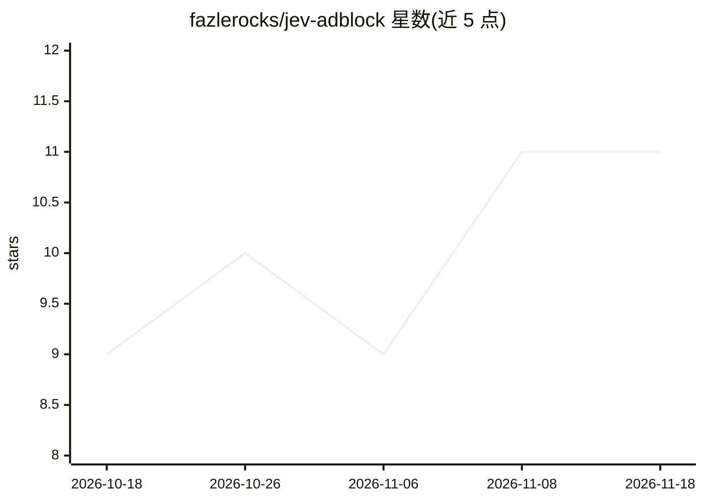

# fazlerocks/jev-adblock

⭐ 11 · TypeScript · MIT · 推送 2026-09-22 · [GitHub](https://github.com/fazlerocks/jev-adblock) · 个人维护

**Chrome AI 广告拦截扩展：用 Jev 模型判定元素是否为广告**

Manifest V3 的 Chrome 扩展，不使用过滤规则清单：内容脚本用启发式找出疑似广告元素，压缩为结构化描述后批量发送给 TypeSafe AI 的 Jev 决策模型，返回六类概率，代码按阈值隐藏元素。判定结果按主机与结构指纹缓存七天，重复命中转为 CSS 规则。需用户自备 TypeSafe API key，按 token 计费，设每日预算上限；不含密码/支付字段的页面不分析，失败时 fail open。仅支持元素隐藏，不做网络层拦截，暂不支持 Firefox/Safari。

## 筛选速览

| 维度 | 判定 | 备注 |
|---|---|---|
| AI 角色 | `ai-native` | 本体是模型或模型工具 |
| 许可风险 | `permissive` | MIT |
| 部署形态 | `library` | 以包/库形式分发 |
| 模型依赖 | — | README 未给出锁定关系 |
| 硬件要求 | — | 无带数字的原话,不猜 |
| 安装摩擦 | `low` | 无编译、无系统依赖或容器化 |
| 成熟度 | — | 结构信号不足 |

## 能力要点

- 无过滤清单：Jev 模型对每个疑似元素返回六类校准概率
- 判定缓存七天，重复命中转为绘制前 CSS 规则
- 每日 token 预算、熔断器与支付/登录/captcha iframe 永不触碰清单
- 无运行时依赖、无遥测，MIT 许可

## 适用场景

- 隐藏新闻页面上的展示广告与赞助卡片
- 评估 Jev 模型做分类/路由的接入方式
- 在 Chrome Manifest V3 环境试用无清单广告拦截

## 场景标签

 · 领域:浏览器工具/隐私

## 证据(README 行号)

> L16: Jev Ad Blocker is a free, open-source Chrome extension (Manifest V3) that blocks ads without downloading or maintai
> L24: Jev is TypeSafe's "System One" model. You send it *state* and typed *questions*; it returns calibrated probabilitie
> L162: Cheap heuristics pick out elements that might be ads: third-party iframes, standard ad sizes, ad-tech attributes, 

## 星数曲线

2026-10-18 9 → 2026-11-18 11（+2）

---
*卡片 v1 · prompt 1.4 · 生成 2026-11-18 · 置信度 high · 依据 README sha `ee54a3775000` · [字段定义](../../DATASET.md)*
