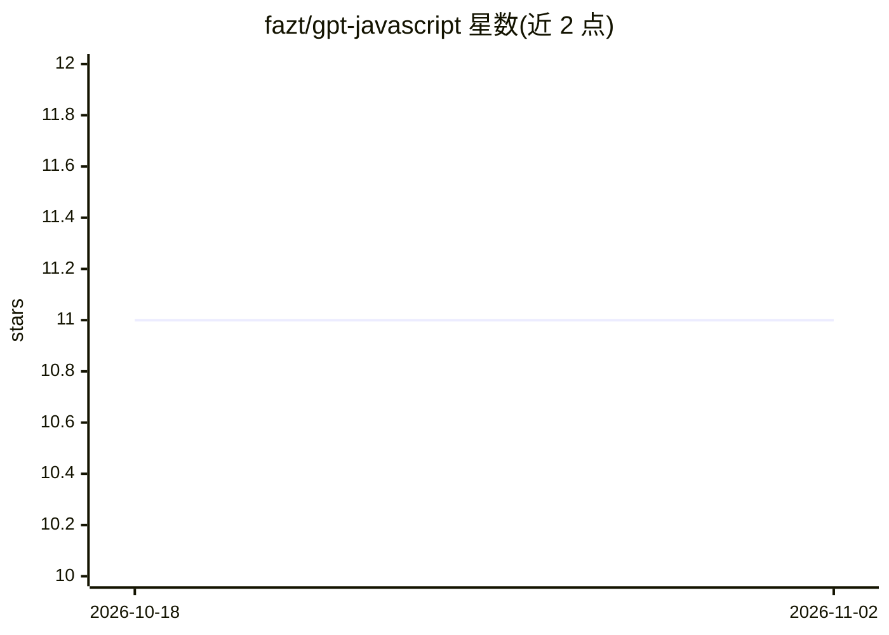

# fazt/gpt-javascript

⭐ 11 · JavaScript · 推送 2026-05-09 · [GitHub](https://github.com/fazt/gpt-javascript) · 个人维护

**用 Node.js 后端安全调用 OpenAI 的小型 JavaScript 应用**

一个小型 JavaScript 应用：前端发送 prompt，Node.js 后端通过 OPENAI_API_KEY 环境变量持有密钥并调用 OpenAI，避免将 API key 暴露在浏览器端。要求 Node.js 20+ 与 OpenAI API key，npm install 后配置 .env 运行，提供 /api/health 与 /api/generate 两个后端端点，支持通过 OPENAI_MODEL 环境变量覆盖默认模型。

## 筛选速览

| 维度 | 判定 | 备注 |
|---|---|---|
| AI 角色 | `ai-native` | 本体是模型或模型工具 |
| 许可风险 | `none` | — |
| 部署形态 | `library` | 以包/库形式分发 |
| 模型依赖 | — | README 未给出锁定关系 |
| 硬件要求 | — | 无带数字的原话,不猜 |
| 安装摩擦 | `low` | 无编译、无系统依赖或容器化 |
| 成熟度 | — | 结构信号不足 |

## 能力要点

- API key 保存在服务端环境变量，不暴露给浏览器
- 提供 /api/health 与 /api/generate 端点
- 支持 OPENAI_MODEL 环境变量覆盖模型选择

## 适用场景

- 学习如何用 Node.js 后端安全代理 OpenAI 请求
- 作为前端应用接入 OpenAI 的最小示例骨架

## 场景标签

`教程课程` · 领域:学习与行业

## 证据(README 行号)

> L3: A small JavaScript app that sends prompts to OpenAI using a Node.js backend.
> L43: - `POST /api/generate` sends `{ "prompt": "..." }` to the backend, which calls OpenAI without exposing the API key 

## 星数曲线

2026-10-18 11 → 2026-11-02 11（+0）

---
*卡片 v1 · prompt 1.4 · 生成 2026-11-02 · 置信度 high · 依据 README sha `2c9ff380ae02` · [字段定义](../../DATASET.md)*
