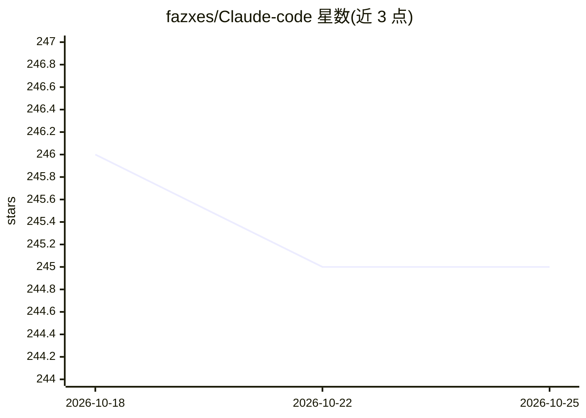

# fazxes/Claude-code

⭐ 245 · TypeScript · 推送 2026-04-03 · [GitHub](https://github.com/fazxes/Claude-code) · 个人维护

**从泄露源码重建的 Claude Code 终端 AI 编程助手 CLI**

基于 2026 年 3 月 npm 包中 .map 文件意外暴露的 Anthropic Claude Code 完整 TypeScript 源码重建的可运行 CLI，约 1,900 个源文件、51 万余行代码。提供自然语言交互的 agentic 编程功能与终端 UI，核心工具（Bash/Edit/Read/Grep 等）和 MCP 支持可用；Computer Use、Chrome 集成等内部功能以空操作占位。声明仅供教育研究、非 Anthropic 官方，可能被下架。需 Bun v1.1+ 从源码构建，OAuth 认证，默认发送遥测可用环境变量禁用。

## 筛选速览

| 维度 | 判定 | 备注 |
|---|---|---|
| AI 角色 | `ai-native` | 本体是模型或模型工具 |
| 许可风险 | `none` | — |
| 部署形态 | `None` |  |
| 模型依赖 | — | README 未给出锁定关系 |
| 硬件要求 | — | 无带数字的原话,不猜 |
| 安装摩擦 | `low` | 无编译、无系统依赖或容器化 |
| 成熟度 | — | 结构信号不足 |

## 能力要点

- 约 1,900 个源文件、512,000+ 行 TypeScript 重建为可运行 CLI
- 核心 CLI、标准工具集与 MCP 支持、完整终端 UI 可用
- Bun 打包为单个 ~21MB dist/cli.js，支持交互与非交互模式
- 可用 DISABLE_TELEMETRY 等环境变量禁用遥测

## 适用场景

- 研究生产级 AI 编程 agent 的架构与工程实现
- 从源码构建并运行 Claude Code CLI 的完整终端体验
- 学习 React/Ink 终端 UI 与 CLI 工具链设计

## 场景标签

`编码 Agent` · 领域:编码与开发

## 证据(README 行号)

> L5: On March 31, 2026, the full source code of Anthropic's Claude Code CLI was leaked via a `.map` file exposed in their
> L27: bun dist/cli.js -p "your prompt"   # Non-interactive mode (pipe-friendly)
> L68: The core CLI, all standard tools (Bash, Edit, Read, Write, Grep, Glob, etc.), MCP support, and the full terminal UI

## 星数曲线

2026-10-18 246 → 2026-10-25 245（-1）

---
*卡片 v1 · prompt 1.4 · 生成 2026-10-22 · 置信度 high · 依据 README sha `52cfa29444a3` · [字段定义](../../DATASET.md)*
