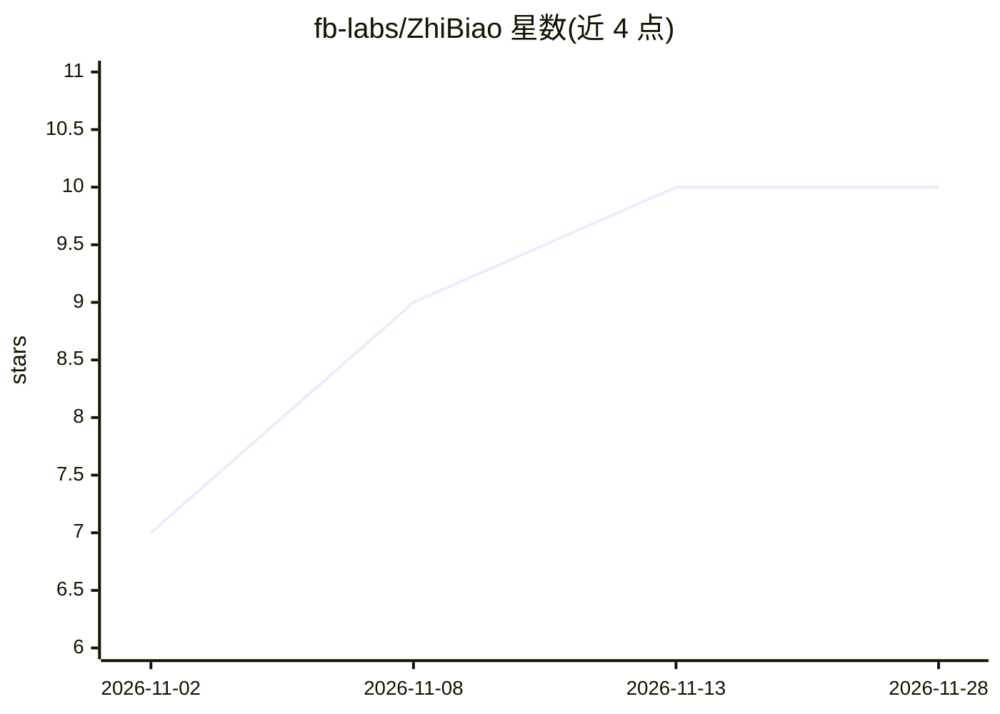

# fb-labs/ZhiBiao

⭐ 10 · Python · AGPL-3.0 · 推送 2026-11-06 · [GitHub](https://github.com/fb-labs/ZhiBiao) · 组织维护 · 中文 README

**面向投标团队的招标解析与标书生成平台**

B/S 架构的招投标全流程平台：上传招标文件后由六个 Agent（招标解析、生成规划、正文编制、核对、修复、模板）依次完成招标解读、大纲规划、逐章正文编写、按原文事实核对与修订建议，最终导出 DOCX/PDF。Agent 采用工具循环执行，模型不可用时回落到确定性实现；支持评分对齐等三种生成结构、OCR 识别扫描件（默认关闭）与标书配图生成（默认关闭）。面向编写投标文件的企业用户，以 AGPL-3.0 发布。

## 筛选速览

| 维度 | 判定 | 备注 |
|---|---|---|
| AI 角色 | `ai-native` | 本体是模型或模型工具 |
| 许可风险 | `viral` | AGPL-3.0 |
| 部署形态 | `self-host` | docker 或自建部署 |
| 模型依赖 | — | README 未给出锁定关系 |
| 硬件要求 | — | 无带数字的原话,不猜 |
| 安装摩擦 | `low` | 无编译、无系统依赖或容器化 |
| 成熟度 | — | 结构信号不足 |

## 能力要点

- 六个 Agent 工具循环：解析、规划、逐章写作、核对、修复、模板抽取
- 基于招标原文事实的逐项核对与修订建议生成
- 兼容任意 OpenAI 协议模型服务，可按步骤分别指定模型
- 导出 DOCX/PDF，含模板版式、目录页码与页眉页脚归一

## 适用场景

- 从招标文件自动生成投标文件草稿并逐章编辑
- 成稿后按招标要求核对报价、工期、材料等一致性
- 扫描版招标文件开启 OCR 后解析识别

## 场景标签

`OCR` `文档解析` `AI 写作` · 领域:内容生成

## 证据(README 行号)

> L46: 4. **招标解读**：招标解析 Agent 读取原文，抽取项目事实台账，并生成项目概况、评分办法、实质性要求与风险项。
> L91: |招标解析 Agent|抽取项目身份、材料、参数、资格、承诺、模板章节，保存事实台账并生成解读报告|压缩要点、OCR 识别、关键词检索、读解读、保存事实、生成解读|
> L98: Agent 采用工具循环：模型每轮输出一个 JSON 动作，服务端执行工具并继续，直到完成或达到最大步数。招标解读、大纲规划、正文编写、质量检查四个流程步骤默认由 Agent 执行；模型不可用时自动回落到同一份确定性实现，保证流程

## 星数曲线

2026-11-02 7 → 2026-11-28 10（+3）

---
*卡片 v1 · prompt 1.4 · 生成 2026-11-19 · 置信度 high · 依据 README sha `870e03532159` · [字段定义](../../DATASET.md)*
