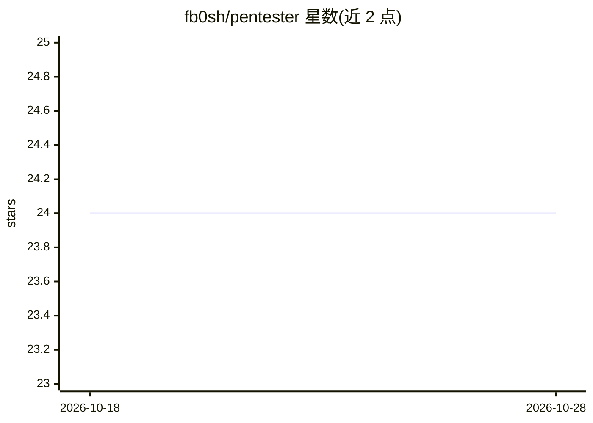

# fb0sh/pentester

⭐ 24 · Markdown · MIT · 推送 2026-07-28 · [GitHub](https://github.com/fb0sh/pentester) · 个人维护 · 中文 README

**AI Agent 驱动的 PTES 渗透测试工作流框架**

面向安全测试人员的渗透测试自动化框架：用支持 AGENTS.md 的 AI Agent 打开仓库，按 PTES 阶段链（0→1→1b?→2→3→4→5→6）执行从情报收集、威胁建模、漏洞验证、利用到后渗透与报告的全流程。以 schema.json 门禁保证不跳步、不漏证据、不越权，未确认授权不得进入进攻阶段；scope-check.js 与 guard.js 强制范围校验。运行需 Node.js 与支持 AGENTS.md 的 Agent，工具可跑在 Kali Docker 容器，产物为可校验的工作区与报告。

## 筛选速览

| 维度 | 判定 | 备注 |
|---|---|---|
| AI 角色 | `ai-ecosystem` | LLM/agent 周边工具 |
| 许可风险 | `permissive` | MIT |
| 部署形态 | `self-host` | docker 或自建部署 |
| 模型依赖 | — | README 未给出锁定关系 |
| 硬件要求 | — | 无带数字的原话,不猜 |
| 安装摩擦 | `low` | 无编译、无系统依赖或容器化 |
| 成熟度 | — | 结构信号不足 |

## 能力要点

- PTES 全生命周期的 skill 流水线与 schema 门禁（不跳步、不漏证据、不越权）
- 授权确认前禁止进攻动作，scope-check.js/guard.js 强制 Scope 校验
- 阶段串行、阶段内 subagent 并行的编排机制
- 生成结构化工作区、已验证漏洞台账与用户语言的交付报告

## 适用场景

- 让 AI Agent 按标准流程对授权目标做渗透测试
- 生成带证据链与覆盖度台账的客户报告
- 对已完成的评估做复测差分

## 场景标签

`工作流自动化` `网络安全` · 领域:效率与自动化

## 证据(README 行号)

> L3: AI 驱动的 **PTES** 渗透测试工作流：用支持 `AGENTS.md` 的 Agent 打开本仓库，按阶段产出可校验的 `target/${ID}/` 工作区与报告。
> L20: 需要：Node.js、Docker（可选 Kali 容器）、能加载 `AGENTS.md` 的 Agent。
> L62: **阶段顺序串行**（`0→1→1b?→2→3→4→5→6` 不可打乱）；**阶段内部并行**：独立 / 长耗时 / 大字典任务必须拆 **subagent**，主 Agent 只编排、维护 **Task List**、合并 Sc

## 星数曲线

2026-10-18 24 → 2026-10-28 24（+0）

---
*卡片 v1 · prompt 1.4 · 生成 2026-10-27 · 置信度 mid · 依据 README sha `de3ed3e7c2fe` · [字段定义](../../DATASET.md)*
