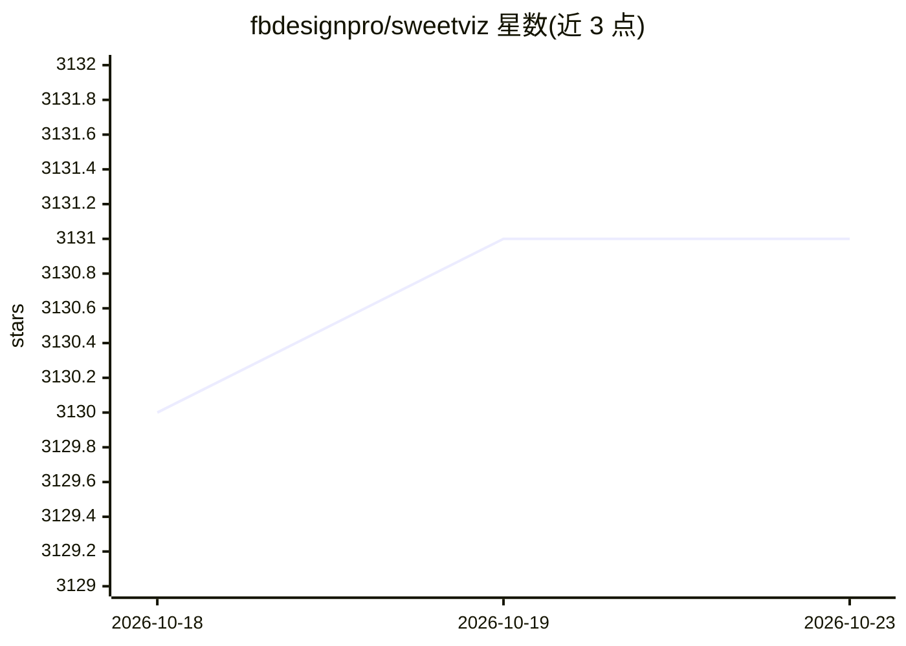

# fbdesignpro/sweetviz

⭐ 3,131 · Python · MIT · 推送 2026-04-11 · [GitHub](https://github.com/fbdesignpro/sweetviz) · 个人维护

**两行代码生成 EDA 可视化报告的 Python 库**

开源 Python 库，面向 pandas DataFrame 做探索性数据分析：通过 analyze()/compare()/compare_intra() 三个函数生成自包含 HTML 报告或 notebook 内嵌报告。功能包括目标值与特征的关联分析、两个数据集或同集子群对比、混合类型关联（Pearson 相关、不确定系数、相关比）、自动类型推断、缺失值/重复行/统计量摘要。支持 Python 3.6+、Pandas 0.25.3+，通过 pip 安装，可经 INI 文件覆盖默认配置，含 CJK 字体选项。目标特征目前仅限布尔与数值类型。

## 筛选速览

| 维度 | 判定 | 备注 |
|---|---|---|
| AI 角色 | `ai-ecosystem` | LLM/agent 周边工具 |
| 许可风险 | `permissive` | MIT |
| 部署形态 | `library` | 以包/库形式分发 |
| 模型依赖 | — | README 未给出锁定关系 |
| 硬件要求 | — | 无带数字的原话,不猜 |
| 安装摩擦 | `low` | 无编译、无系统依赖或容器化 |
| 成熟度 | — | 结构信号不足 |

## 能力要点

- analyze/compare/compare_intra 三函数生成自包含 HTML 报告
- 混合类型关联分析：数值、类别及类别-数值（相关比）
- 自动类型推断，可用 FeatureConfig 手动覆盖
- INI 配置覆盖默认布局、缩放与 CJK 字体

## 适用场景

- 建模前快速了解数据集的特征分布与缺失情况
- 对比训练集与测试集的分布差异
- 按子群（如性别）拆分对比同一数据集
- 分析目标值与其他特征的关联

## 场景标签

 · 领域:数据分析/数据科学工具

## 证据(README 行号)

> L13: The system is built around quickly **visualizing target values** and **comparing datasets**. Its goal is to help qu
> L30: - **Target analysis**

## 星数曲线

2026-10-18 3,130 → 2026-10-23 3,131（+1）

---
*卡片 v1 · prompt 1.4 · 生成 2026-10-20 · 置信度 mid · 依据 README sha `4680fd674267` · [字段定义](../../DATASET.md)*
