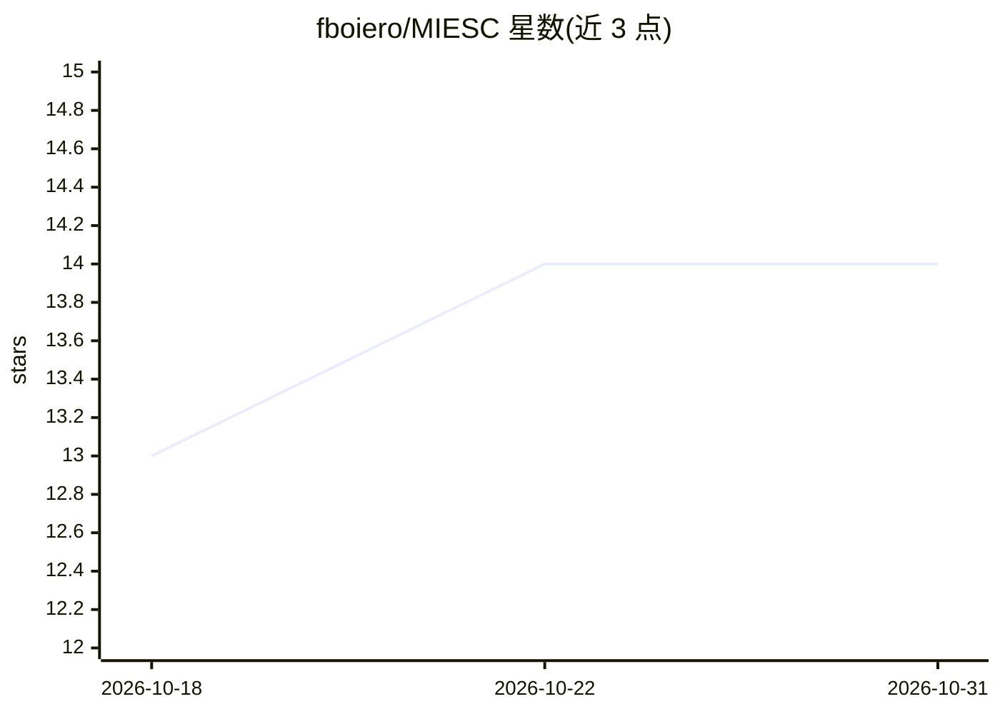

# fboiero/MIESC

⭐ 14 · Python · AGPL-3.0 · 推送 2026-10-27 · [GitHub](https://github.com/fboiero/MIESC) · [官网](https://fboiero.github.io/MIESC/) · 个人维护

**智能合约多层安全评估工具：一条命令编排 50 个工具做预审计**

面向以太坊/EVM 智能合约的预审计分诊 CLI：编排 Slither、Aderyn、Solhint 等 13 个外部安全工具与 16 个内部分析器（共 35 个分析模块、9 层防御），对跨工具结果去重、贝叶斯置信度打分、误报过滤并生成 PDF 审计报告；管道覆盖检测→自动修复→验证（SMT）→MiCA/DORA 合规映射。可选接入本地 Ollama 或前沿 API 做 LLM 分析，纯静态 LLM-free 配置也可运行。当前 EVM 路径为生产核心，非 EVM 链在路线图中。Python 3.12+，pip 安装。

## 筛选速览

| 维度 | 判定 | 备注 |
|---|---|---|
| AI 角色 | `ai-enhanced` | 去掉 AI 部分产品仍成立 |
| 许可风险 | `viral` | AGPL-3.0 |
| 部署形态 | `self-host` | docker 或自建部署 |
| 模型依赖 | local-ok | 支持本地模型 |
| 硬件要求 | — | 无带数字的原话,不猜 |
| 安装摩擦 | `low` | 无编译、无系统依赖或容器化 |
| 成熟度 | `idea` | |

## 能力要点

- 一条命令编排 13 个外部工具 + 16 个内部分析器，跨工具结果去重与置信度打分
- 检测→自动补丁→SMT 验证→MiCA/DORA/ISO 27001 合规映射→PDF 报告的完整管道
- LLM-free 静态配置可本地运行，也可选 Ollama 本地模型或前沿 API 增强召回
- 提供 GitHub Action CI/CD 集成与 SARIF 输出

## 适用场景

- DeFi 项目部署前跑一次免费预审计分诊，再决定是否请正式审计
- 在 CI 中对 PR 变更的合约文件自动扫描安全漏洞
- 将扫描结果自动映射到 MiCA/DORA 合规要求并出报告

## 场景标签

`网络安全` · 领域:学习与行业

## 证据(README 行号)

> L27: pip install miesc
> L31: That's it. MIESC runs Slither + Aderyn + Solhint, deduplicates findings, and gives you a unified report with confid
> L92: |Static layer only|82.5%|118/143|`paper1_ablation_l1_raw_20261015.json`|
> L174: |**LLM analysis modules**|6|SmartLLM, GPTScan, PropertyGPT (via local Ollama)|

## 星数曲线

2026-10-18 13 → 2026-10-31 14（+1）

---
*卡片 v1 · prompt 1.4 · 生成 2026-10-31 · 置信度 mid · 依据 README sha `c4024dfeb486` · [字段定义](../../DATASET.md)*
