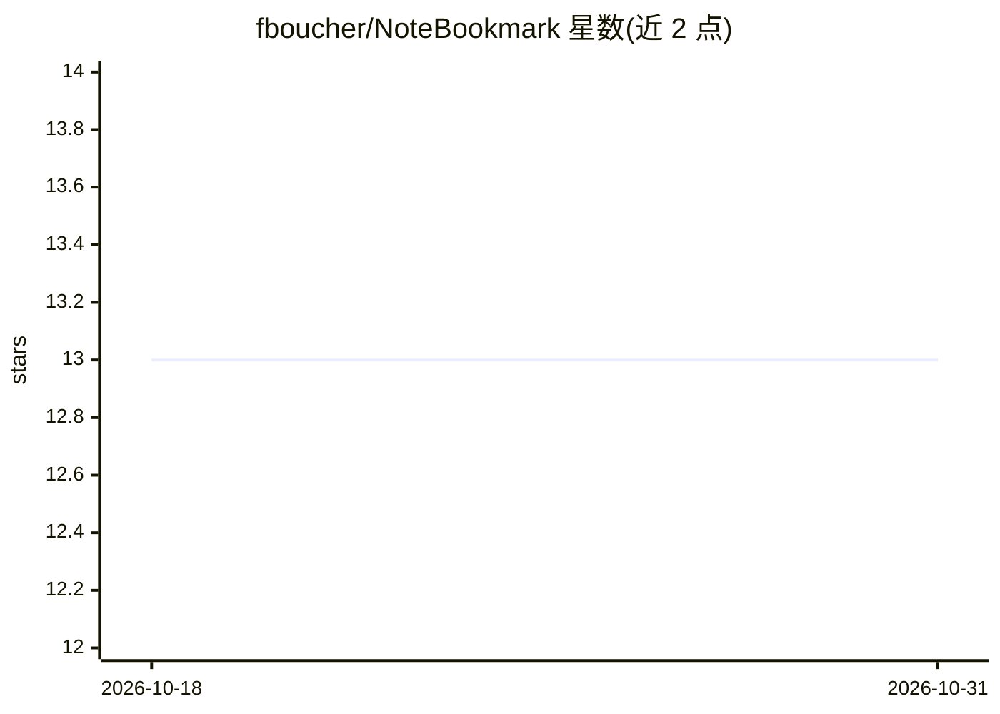

# fboucher/NoteBookmark

⭐ 13 · C# · 推送 2026-10-27 · [GitHub](https://github.com/fboucher/NoteBookmark) · 个人维护

**个人阅读笔记管理与周汇总生成的 Web 应用**

基于 .NET Aspire + Blazor 的 Web 应用：管理“待读”文章与博客列表、为其添加笔记，并通过 AI 生成汇总，聚合为 Reading Notes 博文；包含 Post、Generate Summary、Summaries 三个部分。支持本地 Aspire 运行、azd 部署到 Azure Container Apps，文档提供 Keycloak 认证配置、Docker Compose 部署与 AI Provider 配置（OpenCode/OpenRouter/Ollama 示例），并标注 OpenAI Compatible。另有 .NET MAUI Android 版本徽章。

## 筛选速览

| 维度 | 判定 | 备注 |
|---|---|---|
| AI 角色 | `ai-enhanced` | 去掉 AI 部分产品仍成立 |
| 许可风险 | `none` | — |
| 部署形态 | `self-host` | docker 或自建部署 |
| 模型依赖 | local-ok | 支持本地模型 |
| 硬件要求 | — | 无带数字的原话,不猜 |
| 安装摩擦 | `low` | 无编译、无系统依赖或容器化 |
| 成熟度 | — | 结构信号不足 |

## 能力要点

- 管理待读文章并添加个人笔记
- AI 生成阅读汇总并聚合为 Reading Notes 博文
- Aspire 本地运行 + azd 一键部署 Azure Container Apps
- 可配置 Keycloak 认证与 Docker Compose 部署

## 适用场景

- 收集一周内阅读的文章和博客并记录想法
- 自动生成每周 Reading Notes 博客汇总
- 部署一个自托管的阅读笔记与汇总工具

## 场景标签

`知识库管理` `AI 写作` · 领域:内容生成

## 证据(README 行号)

> L11: - **Generate Summary**: where you can generate a summary of the posts you read.
> L66: - AI Provider Setup - Configure the AI provider (API key, Base URL, model) with OpenCode, OpenRouter or Ollama exam

## 星数曲线

2026-10-18 13 → 2026-10-31 13（+0）

---
*卡片 v1 · prompt 1.4 · 生成 2026-10-31 · 置信度 mid · 依据 README sha `9adb05ebd059` · [字段定义](../../DATASET.md)*
