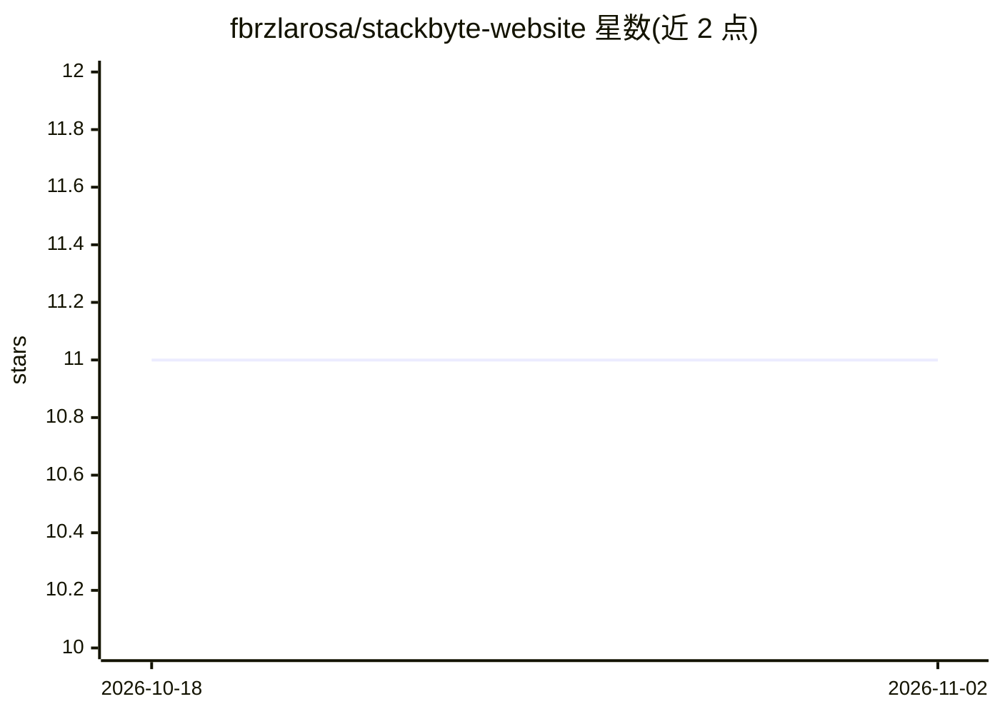

# fbrzlarosa/stackbyte-website

⭐ 11 · TypeScript · 推送 2026-11-01 · [GitHub](https://github.com/fbrzlarosa/stackbyte-website) · [官网](https://stackbyte.dev) · 个人维护

**个人作品集网站：Next.js+GSAP，全流程 AI 辅助开发**

基于 Next.js 16、React 19、TypeScript 与 Tailwind CSS 4 构建的个人作品集网站，使用 GSAP 与 Lenis 实现动画和滚动效果。功能含实时状态追踪（在线/离线/假期，本地脚本监测桌面空闲时间并定期更新）、Cloudflare Turnstile 验证的联系方式、SEO 与站点地图生成。README 声明整个项目通过 AI 辅助开发（vibe coding）完成，但网站运行本身不依赖 AI 功能。需 Node.js 18+，通过 npm/yarn/pnpm 安装依赖运行。

## 筛选速览

| 维度 | 判定 | 备注 |
|---|---|---|
| AI 角色 | `ai-enhanced` | 去掉 AI 部分产品仍成立 |
| 许可风险 | `none` | — |
| 部署形态 | `library` | 以包/库形式分发 |
| 模型依赖 | — | README 未给出锁定关系 |
| 硬件要求 | — | 无带数字的原话,不猜 |
| 安装摩擦 | `low` | 无编译、无系统依赖或容器化 |
| 成熟度 | — | 结构信号不足 |

## 能力要点

- Next.js 16 + React 19 + TypeScript + Tailwind CSS 4 技术栈
- GSAP 3D 动画与 ScrollTrigger 滚动效果
- 实时状态追踪：本地脚本每 30 秒检测桌面空闲并更新状态
- README 声明 100% AI 辅助开发（vibe coding）

## 适用场景

- 搭建个人作品集/作品展示网站
- 展示实时在线状态供访客查看
- 参考 AI 辅助开发的 Next.js 项目实践

## 场景标签

 · 领域:Web/个人网站

## 证据(README 行号)

> L7: **This entire project was crafted using AI-assisted development (vibe coding)**
> L247: This project was **entirely developed using AI-assisted coding** (vibe coding). Every component, animation, and fe

## 星数曲线

2026-10-18 11 → 2026-11-02 11（+0）

---
*卡片 v1 · prompt 1.4 · 生成 2026-11-02 · 置信度 mid · 依据 README sha `6013ce442bc9` · [字段定义](../../DATASET.md)*
