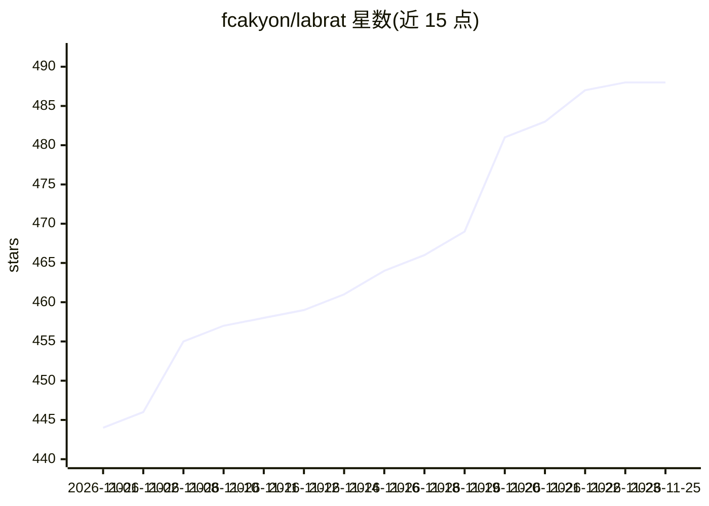

# fcakyon/labrat

⭐ 488 · Python · MIT · 推送 2026-11-18 · [GitHub](https://github.com/fcakyon/labrat) · 个人维护

**让 AI 编码代理按 ML 科研流程复现论文与设计实验的技能插件**

Lab Rat 是一组面向 AI 编码代理的科研技能插件，覆盖文献检索、论文复现、实验设计、训练启动前检查、调试、同 epoch 对比、数据集审查、论文检查与写作、rebuttal 等 11 个技能。作者称其护栏规则源自 2200+ 次 Claude Code/Codex 会话中的真实错误案例。支持安装到 Claude Code、Claude.ai/Desktop、Codex、Cursor 和 Gemini CLI；其中同行评审 hook 与通知仅在 Claude Code 中运行，论文检索需另装 Paper Search CLI（uv、Python 3.10+）。

## 筛选速览

| 维度 | 判定 | 备注 |
|---|---|---|
| AI 角色 | `ai-knowledge` | 知识聚合/清单类 |
| 许可风险 | `permissive` | MIT |
| 部署形态 | `None` |  |
| 模型依赖 | — | README 未给出锁定关系 |
| 硬件要求 | — | 无带数字的原话,不猜 |
| 安装摩擦 | `low` | 无编译、无系统依赖或容器化 |
| 成熟度 | — | 结构信号不足 |

## 能力要点

- 11 个科研技能：文献检索、复现、实验设计、launch、compare、rebuttal 等
- fresh-context 研究同行评审 hook，逐条核对结论与实际产物（仅 Claude Code）
- 同一套技能可在 Claude Code、Codex、Cursor、Gemini CLI 中使用
- 长训练任务可与 /loop 搭配定期检查实验日志并通知

## 适用场景

- 让代理按相同 epoch 复现论文并对比基线
- 启动训练前做 pre-flight 检查清单避免浪费算力
- 准备 CVPR/LaTeX 稿件并预演审稿人问题

## 场景标签

`科研工具` · 领域:学习与行业

## 证据(README 行号)

> L3: Lab Rat teaches your AI coding agent to work like a careful ML researcher: reproduce papers, launch and compare runs
> L13:  Find papers, reproduce, design, launch, compare and publish, with compare looping back to design for the next expe
> L60: Every tool gets the same 11 skills. The research peer review and notifications run in Claude Code only. Paper searc

## 星数曲线

2026-11-01 444 → 2026-11-25 488（+44）

---
*卡片 v1 · prompt 1.4 · 生成 2026-11-25 · 置信度 high · 依据 README sha `2367373a393a` · [字段定义](../../DATASET.md)*
