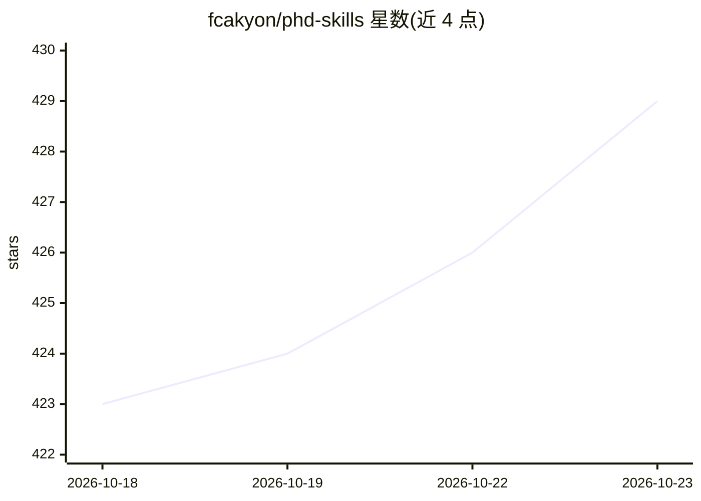

# fcakyon/phd-skills

⭐ 429 · Shell · MIT · 推送 2026-10-11 · [GitHub](https://github.com/fcakyon/phd-skills) · 个人维护

**面向 PhD 科研的 Claude Code 插件：论文复现与实验防护栏**

以 Claude Code 插件形式提供的科研辅助工具集，覆盖 arxiv 论文复现（7 阶段技能）、实验调试、同名 epoch 对齐的实验对比、训练启动预检、文献缺口分析、BibTeX 引用核验与审稿问题预演等命令与自动触发技能。核心机制是 11 项静默运行的研究完整性钩子（guardrails），拦截未验证结论、伪造路径的破坏性命令、未经复核的生成图表等；另含 paper-auditor 与 experiment-analyzer 两个代理，支持 wandb/neptune/tensorboard/mlflow 等来源。MIT 许可，声明零依赖、无需 MCP；论文检索功能需另装 Paper Search CLI（uv + Python 3.10+）。

## 筛选速览

| 维度 | 判定 | 备注 |
|---|---|---|
| AI 角色 | `ai-ecosystem` | LLM/agent 周边工具 |
| 许可风险 | `permissive` | MIT |
| 部署形态 | `None` |  |
| 模型依赖 | locked-api |  |
| 硬件要求 | — | 无带数字的原话,不猜 |
| 安装摩擦 | `low` | 无编译、无系统依赖或容器化 |
| 成熟度 | — | 结构信号不足 |

## 能力要点

- arxiv 论文到复现实验的 7 阶段复现技能
- 11 项静默研究完整性钩子（guardrails）拦截常见 AI 错误
- 跨 wandb/neptune/tensorboard/mlflow/本地的实验分析与同 epoch 对比
- paper-auditor 隔离 worktree 交叉核验论文声明与代码数据

## 适用场景

- 让 Claude Code 按流程复现 arxiv 论文并跑复现实验
- 长训练任务启动前自动执行预检清单，防止误重启或配置漂移
- 论文投稿前核验 BibTeX 引用与代码-论文一致性
- 准备审稿答辩时预演审稿人可能提出的问题

## 场景标签

`科研工具` · 领域:学习与行业

## 证据(README 行号)

> L10: Claude Code Plugin
> L44: - `/phd-skills:reproduce arxiv 2508.12345` reproduce a paper from arxiv URL through replication runs

## 星数曲线

2026-10-18 423 → 2026-10-23 429（+6）

---
*卡片 v1 · prompt 1.4 · 生成 2026-10-21 · 置信度 high · 依据 README sha `b9e855aeab21` · [字段定义](../../DATASET.md)*
