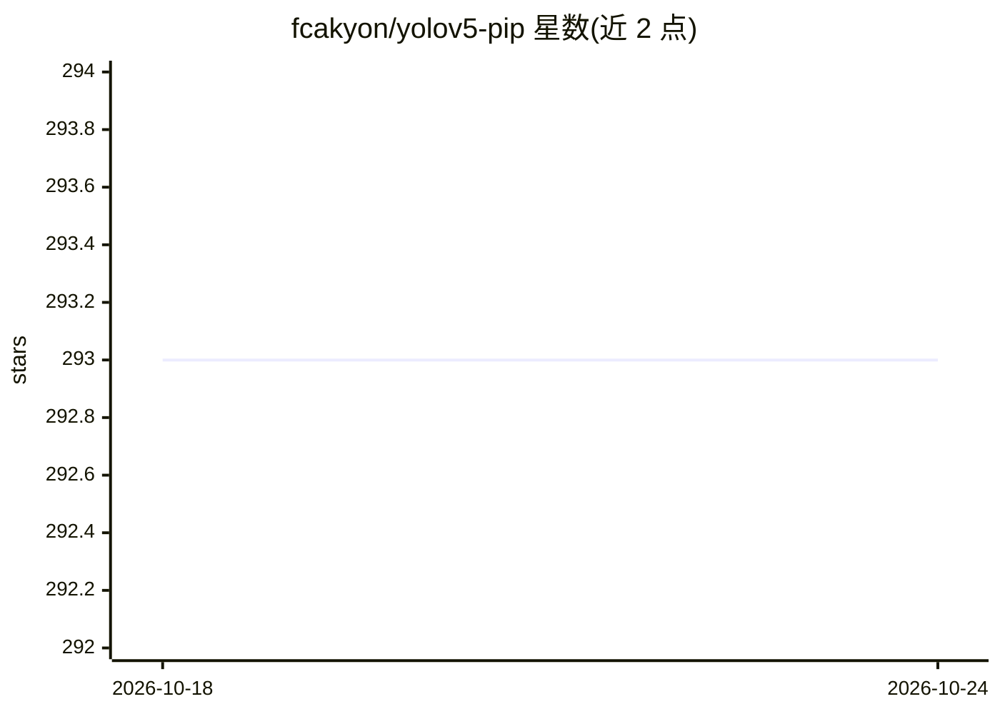

# fcakyon/yolov5-pip

⭐ 293 · Python · GPL-3.0 · 推送 2026-03-20 · [GitHub](https://github.com/fcakyon/yolov5-pip) · [官网](https://pypi.org/project/yolov5/) · 个人维护

**将 ultralytics/yolov5 打包为 pip 库并附加训练与集成功能**

把 ultralytics/yolov5 仓库打包成可 pip 安装的 Python 包，在原功能之上附加：基于 fire 的 CLI（train/detect/val/export/classify/segment）、COCO 数据集格式训练支持、Hugging Face Hub 集成、AWS S3 模型与数据集上传、Neptune.AI 实验记录与 classwise AP 日志。用户可在 Python 或命令行中加载预训练模型执行目标检测、分类、分割的训练与推理，并导出 torchscript/onnx/coreml 等格式。要求 Python >=3.7。

## 筛选速览

| 维度 | 判定 | 备注 |
|---|---|---|
| AI 角色 | `ai-native` | 本体是模型或模型工具 |
| 许可风险 | `viral` | GPL-3.0 |
| 部署形态 | `library` | 以包/库形式分发 |
| 模型依赖 | — | README 未给出锁定关系 |
| 硬件要求 | — | 无带数字的原话,不猜 |
| 安装摩擦 | `low` | 无编译、无系统依赖或容器化 |
| 成熟度 | — | 结构信号不足 |

## 能力要点

- pip 安装 ultralytics/yolov5 全量内容
- CLI 覆盖 train/detect/val/export/classify/segment
- 支持导出 torchscript/onnx/coreml/pb/tflite/tfjs
- 集成 Hugging Face Hub、AWS S3 上传与 Neptune.AI 日志

## 适用场景

- 在 Python 项目中直接调用 YOLOv5 做目标检测
- 用 COCO 格式或 Roboflow 数据集微调模型
- 训练后将权重导出为 ONNX 等部署格式并上传 S3/HF Hub

## 场景标签

`目标检测` `微调` · 领域:感知与多模态

## 证据(README 行号)

> L15: You can finally install YOLOv5 object detector using pip and integrate into your project easily.
> L59: from yolov5 import train, val, detect, export
> L149: yolov5 detect command runs inference on a variety of sources, downloading models automatically from the latest YOL

## 星数曲线

2026-10-18 293 → 2026-10-24 293（+0）

---
*卡片 v1 · prompt 1.4 · 生成 2026-10-22 · 置信度 high · 依据 README sha `c295e7247fb4` · [字段定义](../../DATASET.md)*
