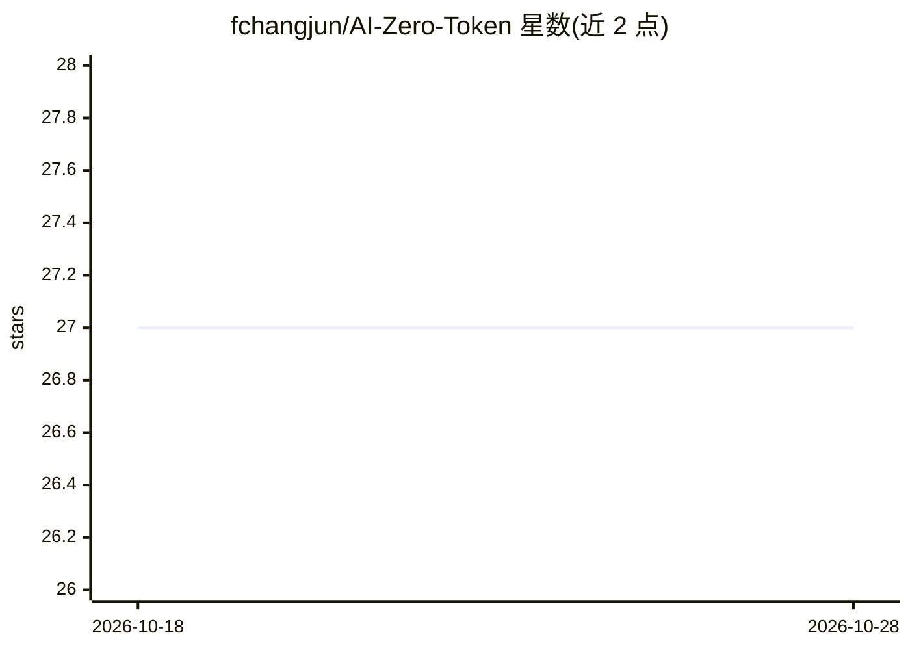

# fchangjun/AI-Zero-Token

⭐ 27 · TypeScript · MIT · 推送 2026-10-27 · [GitHub](https://github.com/fchangjun/AI-Zero-Token) · 个人维护 · 中文 README

**本地 OpenAI 兼容网关：把 ChatGPT/Codex OAuth 账号转成本地 API**

面向本地单用户工作流的 CLI、Web 控制台与 HTTP 网关：用户登录或导入多个 ChatGPT/Codex OAuth 账号，网关以 OpenAI 兼容端点（models/responses/chat/completions/images）转发请求到选定账号，支持多账号切换、配额耗尽自动轮换、账号 JSON/ZIP 批量导入导出、将账号写入 ~/.codex/auth.json 供本地 Codex 使用，以及 gpt-image-2 图像生成与 JSON 图像编辑。自带 Electron 桌面预览与 macOS 菜单栏面板。自声明为实验性工具，不建议作为生产多租户网关。

## 筛选速览

| 维度 | 判定 | 备注 |
|---|---|---|
| AI 角色 | `ai-ecosystem` | LLM/agent 周边工具 |
| 许可风险 | `permissive` | MIT |
| 部署形态 | `library` | 以包/库形式分发 |
| 模型依赖 | — | README 未给出锁定关系 |
| 硬件要求 | — | 无带数字的原话,不猜 |
| 安装摩擦 | `low` | 无编译、无系统依赖或容器化 |
| 成熟度 | `idea` | |

## 能力要点

- OpenAI 兼容本地端点：/v1/models、/v1/responses、/v1/chat/completions、/v1/images/*
- ChatGPT/Codex OAuth 多账号管理与配额耗尽自动切换
- Apply to Codex：备份并更新 ~/.codex/auth.json
- gpt-image-2 图像生成与 JSON 图像编辑

## 适用场景

- 把已有的 ChatGPT/Codex 账号接入 OpenAI 兼容客户端（如 OpenClaw、Codex CLI）
- 本地多个账号之间自动切换以应对配额耗尽
- 在本地工作流中调用 gpt-image-2 做图像生成与编辑

## 场景标签

`模型网关` `图像生成` · 领域:Agent 开发

## 证据(README 行号)

> L5: Local-first OpenAI-compatible gateway for ChatGPT/Codex OAuth accounts.
> L7: AI Zero Token provides a local CLI, web console, and HTTP gateway that expose saved ChatGPT/Codex account capabiliti
> L34: AI Zero Token keeps account tokens and gateway settings in local state, exposes OpenAI-compatible HTTP endpoints, a

## 星数曲线

2026-10-18 27 → 2026-10-28 27（+0）

---
*卡片 v1 · prompt 1.4 · 生成 2026-10-26 · 置信度 high · 依据 README sha `5af26c3782dc` · [字段定义](../../DATASET.md)*
