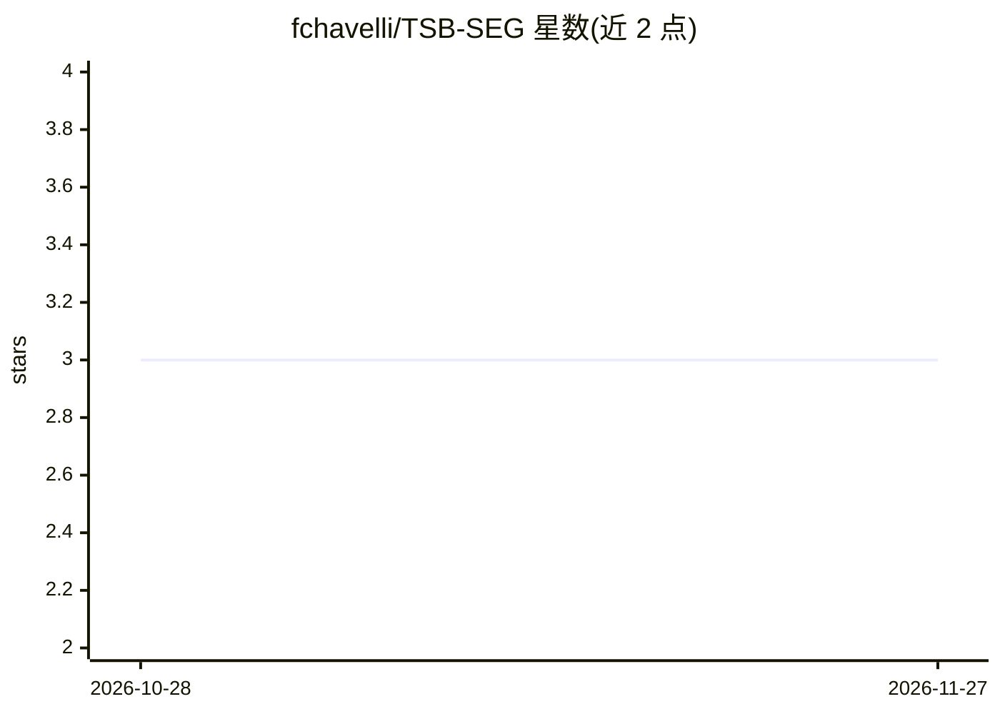

# fchavelli/TSB-SEG

⭐ 3 · Python · AGPL-3.0 · 推送 2026-11-09 · [GitHub](https://github.com/fchavelli/TSB-SEG) · 组织维护

**时间序列分割系统基准：统一评测26种CPD/SD算法**

面向 NeurIPS 2026 论文的基准仓库：在同一套数据与指标下评测时间序列分割的两类任务——变点检测（CPD）与状态检测（SD），覆盖 592 条标注序列、8 个数据集、26 种算法。每方法按 Default 与参数网格、Non-Guided 与 Guided 双轴运行，指标含 BiC、F1、SMS、ARI 等。全部 552,605 次运行结果以 Parquet 发布，可通过 make paper 重建论文图表，无需重跑实验。实验管线基于 Hydra 与 MLflow，支持 SLURM 集群运行。代码为 AGPL-3.0，结果数据为 CC BY 4.0。

## 筛选速览

| 维度 | 判定 | 备注 |
|---|---|---|
| AI 角色 | `ai-knowledge` | 知识聚合/清单类 |
| 许可风险 | `viral` | AGPL-3.0 |
| 部署形态 | `library` | 以包/库形式分发 |
| 模型依赖 | — | README 未给出锁定关系 |
| 硬件要求 | — | 无带数字的原话,不猜 |
| 安装摩擦 | `low` | 无编译、无系统依赖或容器化 |
| 成熟度 | — | 结构信号不足 |

## 能力要点

- 592 条序列、8 数据集、26 算法的统一评测（15 CPD + 6 SD 主池，5 扩展池）
- Default/参数网格与 Non-Guided/Guided 双评测轴
- 全部运行结果以 Parquet 发布，可重建论文全部图表
- 实验管线基于 Hydra + MLflow，支持 SLURM 启动

## 适用场景

- 复现论文中时间序列分割基准的图表与结果
- 在同一协议下评测新提出的分割算法
- 为变点检测或状态检测方法选型参考各数据集表现

## 场景标签

`模型评测` · 领域:评测与运维

## 证据(README 行号)

> L23: **TSB-SEG** is a benchmark for **time series segmentation** that evaluates its
> L6:  Paper: NeurIPS 2026, Evaluations and Datasets Track
> L35: This repository holds the code, configurations and results of the paper. It is

## 星数曲线

2026-10-28 3 → 2026-11-27 3（+0）

---
*卡片 v1 · prompt 1.4 · 生成 2026-11-22 · 置信度 high · 依据 README sha `588bd4192413` · [字段定义](../../DATASET.md)*
