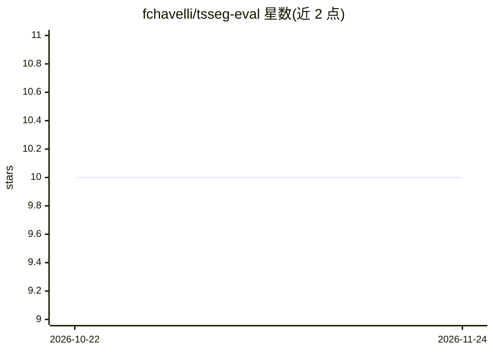

# fchavelli/tsseg-eval

⭐ 10 · Jupyter Notebook · MIT · 推送 2026-05-29 · [GitHub](https://github.com/fchavelli/tsseg-eval) · 个人维护

**时序分割评估指标的 Python 库：提供 WARI 与 SMS 两种度量**

配套 NeurIPS'25 论文的 Python 包，用于评估时间序列分割结果。提供两个评估度量：WARI（ARI 的时间位置加权扩展）与 SMS（识别并打分四种分割错误类型、支持按错误类型加权）。安装方式有二：pip 安装轻量包在自己的项目中调用度量，或克隆仓库并用 conda 环境复现论文实验；实验数据集需从外部链接下载后放入 data 目录，结果输出为 CSV 并提供汇总脚本。

## 筛选速览

| 维度 | 判定 | 备注 |
|---|---|---|
| AI 角色 | `ai-ecosystem` | LLM/agent 周边工具 |
| 许可风险 | `permissive` | MIT |
| 部署形态 | `library` | 以包/库形式分发 |
| 模型依赖 | — | README 未给出锁定关系 |
| 硬件要求 | — | 无带数字的原话,不猜 |
| 安装摩擦 | `low` | 无编译、无系统依赖或容器化 |
| 成熟度 | — | 结构信号不足 |

## 能力要点

- 提供 WARI：考虑分割错误位置的 ARI 时间扩展度量
- 提供 SMS：识别并打分四种分割错误类型，支持错误类型加权
- 在合成与真实基准数据集上验证（MoCap、PAMAP2、UcrSeg 等）
- 提供完整实验复现脚本与结果汇总工具

## 适用场景

- 为自研时序分割算法选择并计算更细粒度的评估指标
- 复现论文中的分割评估实验结果
- 分析分割模型的错误类型与来源（error provenance）

## 场景标签

 · 领域:机器学习/时间序列分析

## 证据(README 行号)

> L13: Time series segmentation is a fundamental task in analyzing temporal data across various domains, from human activi
> L36: To use the evaluation measures (SMS, WARI, etc.) in your own project, you can install the (beta) lightweight packag

## 星数曲线

2026-10-22 10 → 2026-11-24 10（+0）

---
*卡片 v1 · prompt 1.4 · 生成 2026-11-19 · 置信度 high · 依据 README sha `2f1b3fceffe2` · [字段定义](../../DATASET.md)*
