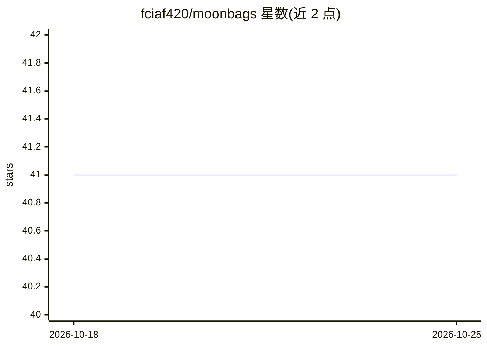

# fciaf420/moonbags

⭐ 41 · TypeScript · 推送 2026-07-12 · [GitHub](https://github.com/fciaf420/moonbags) · 个人维护

**Solana meme 币自动交易机器人，可选 LLM 辅助退出决策**

面向加密交易者的 Solana meme 币交易执行与管理层：从 Private Feed、OKX 聪明钱信号、GMGN 拉取发现流，经 Jupiter Ultra 自动买入，每 3 秒追踪持仓，按可配置的移动止盈/止损退出；可选接入 MiniMax M2.7 LLM，每 30 秒读取链上数据（聪明钱流向、开发者持仓、持仓者 PnL、K 线）决定 hold/tighten_trail/exit_now。通过 Telegram 命令和本地网页面板操控，状态持久化可断点续跑。需 Node.js 20+、多个外部服务账号（Helius/Jupiter/OKX/Telegram），LLM 顾问为可选付费项，不支持原生 Windows。README 声明仅用于教育研究目的。

## 筛选速览

| 维度 | 判定 | 备注 |
|---|---|---|
| AI 角色 | `ai-enhanced` | 去掉 AI 部分产品仍成立 |
| 许可风险 | `none` | — |
| 部署形态 | `self-host` | docker 或自建部署 |
| 模型依赖 | — | README 未给出锁定关系 |
| 硬件要求 | — | 无带数字的原话,不猜 |
| 安装摩擦 | `low` | 无编译、无系统依赖或容器化 |
| 成熟度 | — | 结构信号不足 |

## 能力要点

- 三类信号源（Private Feed/OKX 聪明钱/GMGN）可在运行时经 Telegram /sources 切换
- 持仓每 3 秒追踪，默认静态止盈止损退出
- 可选 MiniMax M2.7 LLM 退出顾问，每 30 秒基于链上快照给出决策
- 一键安装脚本 + 交互式 setup 向导 + /doctor 健康检查，支持 pm2 与 Telegram 自更新

## 适用场景

- 我想让机器人盯 Solana meme 币信号并自动买入卖出
- 用 Telegram 远程查看持仓、调参数、一键卖出
- 让 LLM 基于链上数据决定是否提前退出持仓

## 场景标签

`金融量化` · 领域:学习与行业

## 证据(README 行号)

> L7: MoonBags is the **execution and management layer** for Solana meme-token signals. It consumes real-time discovery st
> L53:  - **LLM advisor** (optional) — every 30s after arming, sends an on-chain snapshot to MiniMax M2.7 which decides `h

## 星数曲线

2026-10-18 41 → 2026-10-25 41（+0）

---
*卡片 v1 · prompt 1.4 · 生成 2026-10-25 · 置信度 mid · 依据 README sha `386ba891f845` · [字段定义](../../DATASET.md)*
