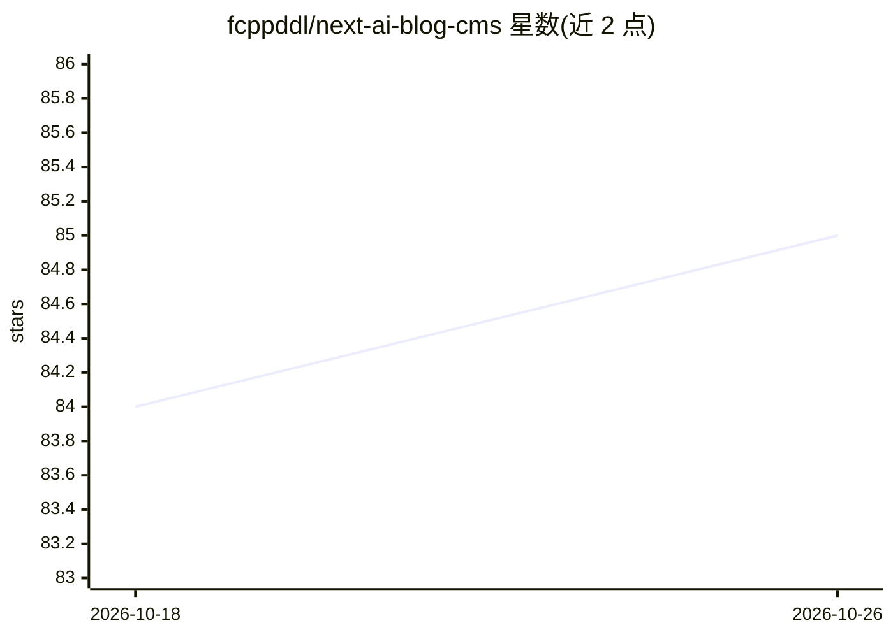

# fcppddl/next-ai-blog-cms

⭐ 85 · TypeScript · 推送 2026-06-22 · [GitHub](https://github.com/fcppddl/next-ai-blog-cms) · [官网](https://fcppddl.top) · 个人维护 · 中文 README

**带 AI 写作助手与 RAG 站内问答的 Next.js 博客 CMS**

基于 Next.js App Router 的博客与后台一体化项目：公开前台、受 NextAuth 保护的 /admin 管理 CMS、Tiptap 富文本/Markdown 编辑器。AI 为可选能力：通过 OpenAI 兼容 API 实现 AI 写作补全与前台流式对话助手；RAG 部分用 Ollama 或外部 Embedding 接口生成文章块向量，存入 ChromaDB 做站内检索问答，含对话上下文裁剪（js-tiktoken）与三级记忆架构。不配置 AI 相关环境变量时可运行最小博客与登录后台。数据层为 SQLite + Prisma 6。

## 筛选速览

| 维度 | 判定 | 备注 |
|---|---|---|
| AI 角色 | `ai-enhanced` | 去掉 AI 部分产品仍成立 |
| 许可风险 | `none` | — |
| 部署形态 | `self-host` | docker 或自建部署 |
| 模型依赖 | local-ok | 支持本地模型 |
| 硬件要求 | — | 无带数字的原话,不猜 |
| 安装摩擦 | `low` | 无编译、无系统依赖或容器化 |
| 成熟度 | — | 结构信号不足 |

## 能力要点

- OpenAI 兼容 API 驱动的 AI 写作与前台流式对话助手（SSE）
- RAG 站内问答：Ollama 或外部 Embedding 接口二选一 + ChromaDB 向量检索，可选重排序
- 对话上下文工程：token 裁剪、摘要锚点压缩与三级记忆架构
- Tiptap 富文本/Markdown 编辑器与 Prisma + SQLite 数据层，AI 配置全部可选

## 适用场景

- 部署一套自带管理后台的个人或团队博客
- 在后台写文章时用 AI 补全辅助写作
- 让访客基于站内文章进行检索式问答

## 场景标签

`AI 写作` `RAG` `聊天机器人` · 领域:对话与助手

## 证据(README 行号)

> L3: 基于 **Next.js App Router** 的博客与后台一体化项目：公开前台、管理员 CMS、AI 写作助手，以及基于向量检索（RAG）的站内智能问答。
> L100: 以下为**可选**（不装则对应功能不可用或降级）：
> L129: **最小可运行博客 + 登录后台**所需示例：

## 星数曲线

2026-10-18 84 → 2026-10-26 85（+1）

---
*卡片 v1 · prompt 1.4 · 生成 2026-10-24 · 置信度 mid · 依据 README sha `2657dfb4d9f3` · [字段定义](../../DATASET.md)*
