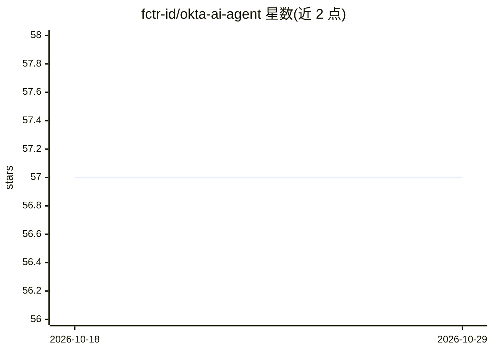

# fctr-id/okta-ai-agent

⭐ 57 · Python · NOASSERTION · 推送 2026-10-11 · [GitHub](https://github.com/fctr-id/okta-ai-agent) · [官网](https://fctr.io/ai-agent.html) · 组织维护

**面向 Okta 管理员的本地优先 AI 查询代理**

自托管的自研 AI agent：Okta 管理员用自然语言查询租户内的用户、组、应用、策略与设备。数据来源可为 Okta Live API、同步到本地 SQLite 的数据或两者结合；系统内置 107 个 Okta 端点指引，生成查询前会先测试，支持追问、CSV 与 Python 脚本导出。接入方式覆盖浏览器、Slack、Teams 与 CLI。支持 OpenAI、Anthropic、Azure OpenAI、AWS Bedrock、Ollama 等多种 AI 供应商，Docker 部署于 AMD64/ARM64。Slack 与 Teams 机器人默认关闭，需 allowlist 控制访问。

## 筛选速览

| 维度 | 判定 | 备注 |
|---|---|---|
| AI 角色 | `ai-native` | 本体是模型或模型工具 |
| 许可风险 | `none` | NOASSERTION |
| 部署形态 | `self-host` | docker 或自建部署 |
| 模型依赖 | local-ok | 支持本地模型 |
| 硬件要求 | — | 无带数字的原话,不猜 |
| 安装摩擦 | `low` | 无编译、无系统依赖或容器化 |
| 成熟度 | — | 结构信号不足 |

## 能力要点

- 自然语言查询 Okta 租户数据，支持追问与 CSV/Python 脚本导出
- Live API、本地 SQLite 同步、混合三种数据来源
- 支持 Slack、Teams、浏览器、CLI 四种使用渠道
- 兼容 OpenAI/Anthropic/Azure/Bedrock/Ollama 等多种 AI 供应商

## 适用场景

- 用自然语言查询 Okta 用户、组、应用与策略
- 把 Okta 数据同步到本地后做快速 SQL 查询与导出
- 在 Slack 或 Teams 中让管理员直接提问租户数据
- 通过 CLI 定时执行查询与同步任务

## 场景标签

`数据分析` · 领域:效率与自动化

## 证据(README 行号)

> L28: **The first AI agent built for Okta.** Ask about users, groups, applications, policies, devices, and access in plai
> L176: Tako supports OpenAI, Google AI Studio, Google Vertex AI, Anthropic, Azure OpenAI, AWS Bedrock, and OpenAI-compati

## 星数曲线

2026-10-18 57 → 2026-10-29 57（+0）

---
*卡片 v1 · prompt 1.4 · 生成 2026-10-24 · 置信度 high · 依据 README sha `2dc91236e764` · [字段定义](../../DATASET.md)*
