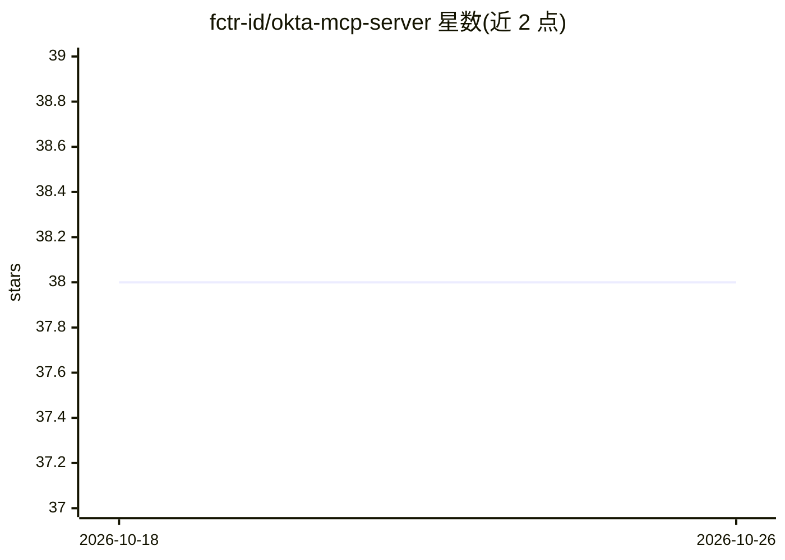

# fctr-id/okta-mcp-server

⭐ 38 · Python · Apache-2.0 · 推送 2026-04-25 · [GitHub](https://github.com/fctr-id/okta-mcp-server) · [官网](https://fctr.io/okta-mcp-server.html) · 组织维护

**让 AI 模型通过 MCP 协议直接管理 Okta 身份环境的服务器**

实现 Model Context Protocol 的 Okta 连接服务器，面向 IAM 工程师、安全团队与 Okta 管理员：把用户/组/应用/策略/网络区域/系统日志等 Okta 管理操作暴露为 MCP 工具，供 Claude Desktop 等 AI 客户端调用，并提供访问分析与登录风险评估两个专用工具。基于 FastMCP 2.0 构建，支持 STDIO/HTTP 传输（HTTP 模式无认证，文档标注安全风险，推荐 STDIO）。需 Python 3.8+ 与 Okta API 权限，仅测试过 GPT-4.0、Claude 3.7 Sonnet、Google-2.5-pro 三种模型。

## 筛选速览

| 维度 | 判定 | 备注 |
|---|---|---|
| AI 角色 | `ai-ecosystem` | LLM/agent 周边工具 |
| 许可风险 | `permissive` | Apache-2.0 |
| 部署形态 | `self-host` | docker 或自建部署 |
| 模型依赖 | local-ok | 支持本地模型 |
| 硬件要求 | — | 无带数字的原话,不猜 |
| 安装摩擦 | `low` | 无编译、无系统依赖或容器化 |
| 成熟度 | `idea` | |

## 能力要点

- 用户/组/应用/策略/网络区域/系统日志等 20 余个 Okta 管理工具
- 访问分析（用户能否访问应用 X）与登录风险（VPN/Tor/地理不可行性检测）专用工具
- 支持 OpenAI/Azure/Anthropic/Vertex AI/OpenAI 兼容端点多供应商配置
- STDIO 与 Streamable HTTP/SSE 传输，JWT bearer token 与 JWKS 校验

## 适用场景

- 通过 Claude Desktop 等客户端对话式查询和排查 Okta 用户访问问题
- 让 AI 快速评估可疑登录行为
- 批量查询近期创建用户、长期未登录用户等轻量运维任务

## 场景标签

`网络安全` · 领域:学习与行业

## 证据(README 行号)

> L11: The Okta MCP Server is a groundbreaking tool that enables AI models to interact directly with your Okta environment
> L70:  The Model Context Protocol (MCP) is an open standard that enables AI models to interact with external tools and se

## 星数曲线

2026-10-18 38 → 2026-10-26 38（+0）

---
*卡片 v1 · prompt 1.4 · 生成 2026-10-25 · 置信度 mid · 依据 README sha `e9e50819be1d` · [字段定义](../../DATASET.md)*
