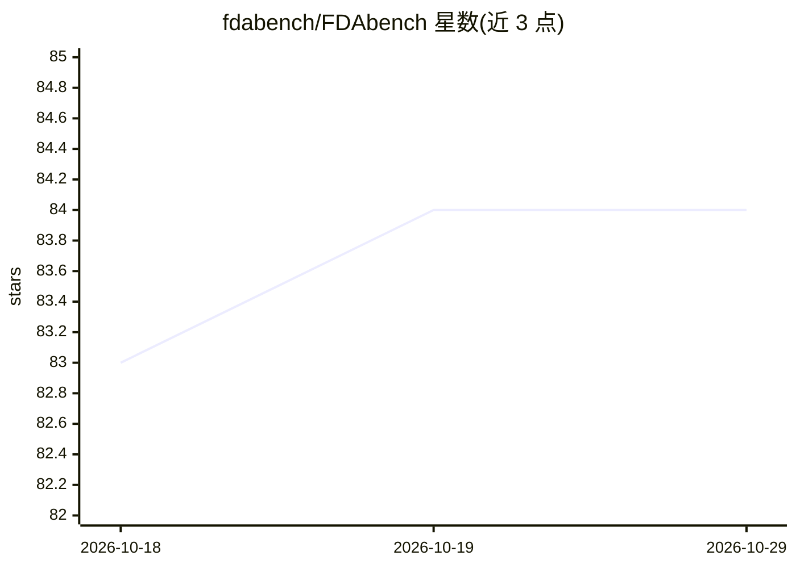

# fdabench/FDAbench

⭐ 84 · Python · MIT · 推送 2026-08-06 · [GitHub](https://github.com/fdabench/FDAbench) · 组织维护

**评测数据智能体的基准：2,007 个异构数据分析任务**

KDD'26 论文 FDAbench 的官方仓库：为异构数据上的分析查询提供评测数据智能体的基准，含 2,007 个任务（Lite 子集 289 个），覆盖单选、多选与开放式报告三类题型，支持 SQLite、BigQuery、Snowflake 及非结构化数据。内置规划、多智能体、反思、工具使用四种智能体实现与 DAG 评测系统，指标包括准确率、rubric 评分、延迟与 token 成本；另提供 PUDDING 智能体-专家协作数据集构建框架，可继承 BaseAgent 接入自定义智能体，结果以 JSONL 提交。

## 筛选速览

| 维度 | 判定 | 备注 |
|---|---|---|
| AI 角色 | `ai-ecosystem` | LLM/agent 周边工具 |
| 许可风险 | `permissive` | MIT |
| 部署形态 | `library` | 以包/库形式分发 |
| 模型依赖 | local-ok | 支持本地模型 |
| 硬件要求 | — | 无带数字的原话,不猜 |
| 安装摩擦 | `low` | 无编译、无系统依赖或容器化 |
| 成熟度 | — | 结构信号不足 |

## 能力要点

- 2,007 个任务（Lite 289 个），三类题型、多难度分级
- DAG 评测系统：准确率、rubric 评分、延迟与 token 成本追踪
- 内置 4 种数据智能体实现，支持继承 BaseAgent 自定义接入
- PUDDING 框架：LLM 生成 + 专家迭代校验的数据集构建

## 适用场景

- 评测我开发的数据智能体在异构数据分析任务上的表现
- 向基准榜单提交评测结果
- 用 PUDDING 框架构建带专家校验的智能体数据集

## 场景标签

`模型评测` `数据分析` · 领域:效率与自动化

## 证据(README 行号)

> L5: (KDD'26) **FDABench** is a benchmark for evaluating data agents on analytical queries over heterogeneous data. It co
> L15: - **Data Agent Implementations**: Ready-to-use agents (Planning, Multi-Agent, Reflection, Tool-Use)
> L253: - **Accuracy**: Correctness for choice questions

## 星数曲线

2026-10-18 83 → 2026-10-29 84（+1）

---
*卡片 v1 · prompt 1.4 · 生成 2026-10-24 · 置信度 high · 依据 README sha `6a32ced8294a` · [字段定义](../../DATASET.md)*
