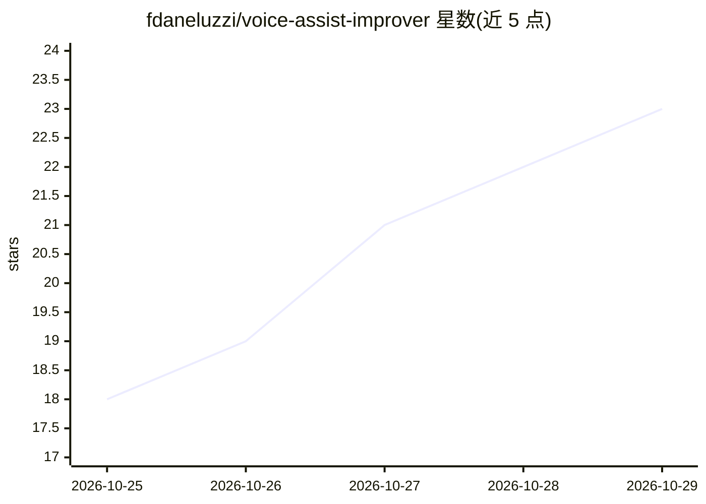

# fdaneluzzi/voice-assist-improver

⭐ 23 · Python · Apache-2.0 · 推送 2026-10-24 · [GitHub](https://github.com/fdaneluzzi/voice-assist-improver) · 个人维护

**Home Assistant Assist 的 LLM 回退应用：记录未识别指令并建议改进**

以 Home Assistant 应用形式运行的 LLM 回退层：对 Home Assistant 伪装成 Ollama 服务器，无需在 HA 内安装组件；调用 Anthropic API（自备 key，可选模型与月度预算上限）回答 Assist 未能理解的语音指令，并可经 MCP Server 集成读取和控制已暴露给 Assist 的实体。每日分析近期回退记录，在 HA 面板中建议别名、自动化、场景与提示，用户确认后由代码验证并应用，全部变更写入审计日志且可撤销。面向 HA OS/Supervised 用户，当前仅支持 Anthropic API 与英语/巴西葡语。

## 筛选速览

| 维度 | 判定 | 备注 |
|---|---|---|
| AI 角色 | `ai-ecosystem` | LLM/agent 周边工具 |
| 许可风险 | `permissive` | Apache-2.0 |
| 部署形态 | `None` |  |
| 模型依赖 | local-ok | 支持本地模型 |
| 硬件要求 | — | 无带数字的原话,不猜 |
| 安装摩擦 | `low` | 无编译、无系统依赖或容器化 |
| 成熟度 | `idea` | |

## 能力要点

- 对 Home Assistant 呈现为 Ollama 服务器的回退通道，调用 Anthropic API
- 每日分析未处理请求并在面板中建议别名/自动化/场景，应用前经代码验证
- 月度预算上限、变更审计日志与 Undo，创建的自动化仅限白名单服务
- 请求本地存储并按 retention_days 过期，未暴露实体对应用不可见

## 适用场景

- 减少家庭语音指令依赖付费 LLM 的频率
- 为常用说法自动生成实体别名或句子触发自动化
- 审查每天哪些请求走了 LLM 回退

## 场景标签

`语音 Agent` · 领域:对话与助手

## 证据(README 行号)

> L29:                └ not understood ─► Ollama agent ─► Voice Assist Improver ─► AI service (Anthropic API)
> L33: 1. **It answers the fallback.** It looks like an Ollama server to Home Assistant, so nothing is installed inside
> L36: 2. **It teaches Assist.** Once a day it reads the recent fallbacks and proposes improvements. You review them in

## 星数曲线

2026-10-25 18 → 2026-10-29 23（+5）

---
*卡片 v1 · prompt 1.4 · 生成 2026-10-28 · 置信度 high · 依据 README sha `e9e608442580` · [字段定义](../../DATASET.md)*
