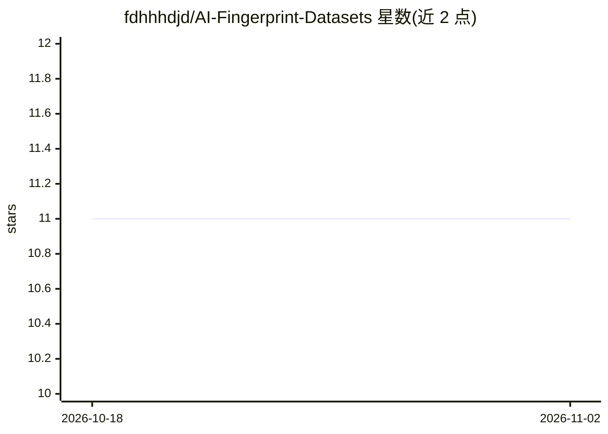

# fdhhhdjd/AI-Fingerprint-Datasets

⭐ 11 · CC0-1.0 · 推送 2026-01-09 · [GitHub](https://github.com/fdhhhdjd/AI-Fingerprint-Datasets) · [官网](https://www.tiktok.com/@code.web.khng.kh) · 个人维护

**指纹数据集策展清单：供识别算法研究与评测选数据**

人工整理的指纹（及部分掌纹）图像数据集目录，覆盖 FVC2000/2002/2004/2006、NIST SD 301/302、CASIA、Neurotechnology 样例集等。按获取方式（public/licensed/secret）与采集形态（rectangular/pairset/latent/unpaired）两级分类，每个条目记录规模、格式与分辨率、许可、下载途径、采集人群与传感器型号。面向指纹识别算法的研究与评测选型，仓库本身不提供数据下载或代码。

## 筛选速览

| 维度 | 判定 | 备注 |
|---|---|---|
| AI 角色 | `ai-knowledge` | 知识聚合/清单类 |
| 许可风险 | `viral` | CC0-1.0 |
| 部署形态 | `None` |  |
| 模型依赖 | — | README 未给出锁定关系 |
| 硬件要求 | — | 无带数字的原话,不猜 |
| 安装摩擦 | `low` | 无编译、无系统依赖或容器化 |
| 成熟度 | — | 结构信号不足 |

## 能力要点

- 覆盖 FVC 系列竞赛数据集与 NIST、CASIA 等数据集的条目级编目
- 按获取方式与采集形态两级分类
- 每条目记录规模、格式分辨率、许可、下载途径与传感器型号

## 适用场景

- 为指纹识别算法训练与评测挑选合适的数据集
- 了解各数据集的许可条款与获取方式
- 比较不同传感器采集的数据集特性

## 场景标签

`精选清单` · 领域:学习与行业

## 证据(README 行号)

> L3: Curated collection of human fingerprint datasets suitable for research and evaluation of fingerprint recognition alg
> L9: By access:

## 星数曲线

2026-10-18 11 → 2026-11-02 11（+0）

---
*卡片 v1 · prompt 1.4 · 生成 2026-11-02 · 置信度 high · 依据 README sha `690e3a7ea27b` · [字段定义](../../DATASET.md)*
