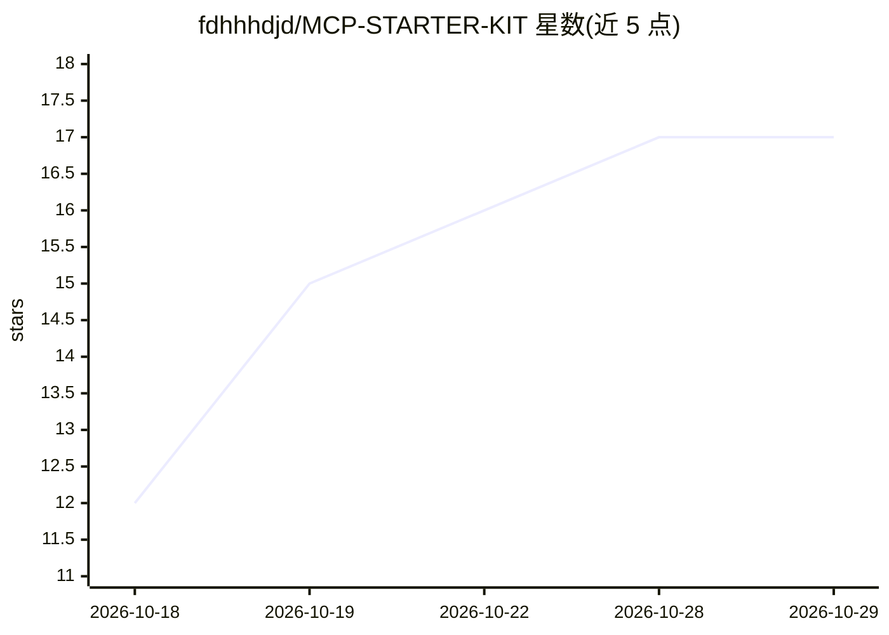

# fdhhhdjd/MCP-STARTER-KIT

⭐ 17 · TypeScript · 推送 2026-09-11 · [GitHub](https://github.com/fdhhhdjd/MCP-STARTER-KIT) · [官网](https://codewebkhongkho.com) · 个人维护

**为任意项目脚手架安全 MCP 服务器的 TypeScript 模板套件**

面向开发者的 MCP 服务器脚手架：把 Claude、ChatGPT 等 AI agent 通过 URL + API key 接到用户自己的后端 API，每个 tool 映射一个后端端点。提供 Streamable HTTP 与 stdio 两种传输，以及带 PKCE 的无状态 OAuth 2.0；内置多项安全配置：初始化时校验 key、会话上限与空闲 TTL 清理、按 IP 限流、SSRF 跨主机阻断、stderr 审计与密钥脱敏、非 root Dockerfile。默认只读，写操作需显式添加 scope。使用流程为填写 feature.md 或运行 SKILL.md 引导，再从 templates/ 生成代码，npm install && npm run build 后经 TLS 反代部署。

## 筛选速览

| 维度 | 判定 | 备注 |
|---|---|---|
| AI 角色 | `ai-ecosystem` | LLM/agent 周边工具 |
| 许可风险 | `none` | — |
| 部署形态 | `self-host` | docker 或自建部署 |
| 模型依赖 | locked-api |  |
| 硬件要求 | — | 无带数字的原话,不猜 |
| 安装摩擦 | `low` | 无编译、无系统依赖或容器化 |
| 成熟度 | — | 结构信号不足 |

## 能力要点

- Streamable HTTP 与 stdio 双传输，兼容 Claude Desktop/Web、ChatGPT、OpenAI API 客户端
- 无状态 OAuth 2.0（PKCE S256）与 header-key 认证并行
- 内置安全加固：initialize 时验 key、会话上限/TTL、限流、SSRF 阻断、审计脱敏
- 默认只读，写 scope 需显式添加

## 适用场景

- 给我的后端 API 快速搭一个可供 AI agent 安全调用的 MCP 服务器
- 让 ChatGPT/Claude 通过 OAuth 连接我的内部服务
- 按模板生成带认证与限流的 MCP 工具服务并部署上线

## 场景标签

`代码生成` · 领域:编码与开发

## 证据(README 行号)

> L15: **MCP Starter Kit** scaffolds a **secure, online MCP (Model Context Protocol) server**
> L21: AI agent ──MCP (Streamable HTTP / stdio / OAuth)──▶ <project>-mcp ──REST + Bearer key──▶ Your backend

## 星数曲线

2026-10-18 12 → 2026-10-29 17（+5）

---
*卡片 v1 · prompt 1.4 · 生成 2026-10-29 · 置信度 mid · 依据 README sha `8e0b952de776` · [字段定义](../../DATASET.md)*
