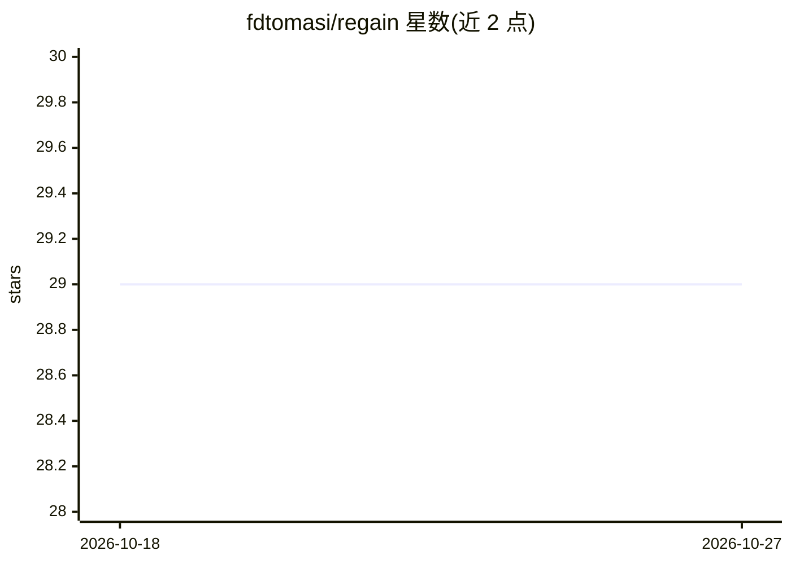

# fdtomasi/regain

⭐ 29 · Jupyter Notebook · BSD-3-Clause · 推送 2026-08-26 · [GitHub](https://github.com/fdtomasi/regain) · 个人维护

**多时间点正则化图推理库，含隐变量，兼容 scikit-learn**

REGAIN 提供 LatentTimeGraphicalLasso、TimeGraphicalLassoForwardBackward 等估计器，在多个时间点上做正则化图推理并考虑隐变量影响；API 继承并保持与 scikit-learn 一致，输入为二维矩阵 X，时间点归属由 y 指示。通过 pip、conda 或源码安装；基于高斯过程的参数选择需额外安装 skopt。方法发表于 KDD 2018 与 AISTATS 2018 两篇论文。

## 筛选速览

| 维度 | 判定 | 备注 |
|---|---|---|
| AI 角色 | `ai-native` | 本体是模型或模型工具 |
| 许可风险 | `permissive` | BSD-3-Clause |
| 部署形态 | `library` | 以包/库形式分发 |
| 模型依赖 | — | README 未给出锁定关系 |
| 硬件要求 | — | 无带数字的原话,不猜 |
| 安装摩擦 | `low` | 无编译、无系统依赖或容器化 |
| 成熟度 | — | 结构信号不足 |

## 能力要点

- 多时间点的正则化图推理，考虑隐变量影响
- API 与 scikit-keep 一致的估计器接口
- 提供数据生成与协方差估计模块
- 两个已发表方法（LTGL、前向-后向分裂）的实现

## 适用场景

- 时间序列数据上的网络/图结构推断
- 存在隐变量干扰的精度矩阵估计
- 在 scikit-learn 流水线中复用 regain 估计器

## 场景标签

 · 领域:机器学习/统计推理

## 证据(README 行号)

> L6: Regularised graph inference across multiple time stamps, considering the influence of latent variables.
> L7: It inherits functionalities from the scikit-learn package.

## 星数曲线

2026-10-18 29 → 2026-10-27 29（+0）

---
*卡片 v1 · prompt 1.4 · 生成 2026-10-26 · 置信度 high · 依据 README sha `f5431b1c8bbb` · [字段定义](../../DATASET.md)*
