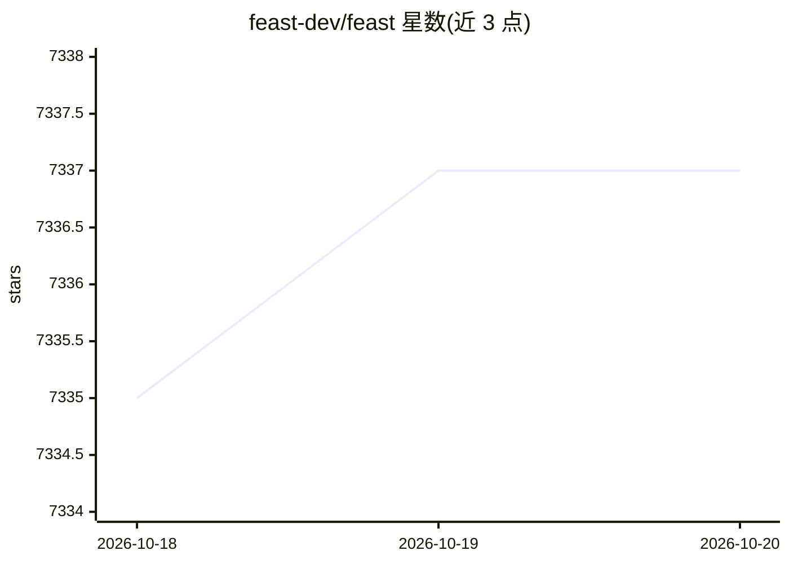

# feast-dev/feast

⭐ 7,337 · Python · Apache-2.0 · 推送 2026-10-18 · [GitHub](https://github.com/feast-dev/feast) · [官网](https://feast.dev) · 组织维护

**开源 ML 特征存储：统一管理训练与在线推理的特征数据**

面向 ML 平台团队的特征存储系统：通过离线存储处理训练与批处理数据，通过低延迟在线存储与特征服务支撑实时预测，生成 point-in-time 正确的数据集以避免数据泄漏，并以统一数据访问层将特征存储与检索解耦。以 pip 安装的 Python 包与 CLI 提供，支持大量数据源（Snowflake/BigQuery/Redshift/Parquet 等）、离线/在线存储后端（Redis/DynamoDB/MySQL/向量库等）及流式摄取，路线图部分功能标注 Alpha/Beta 且项目仍在活跃开发中。

## 筛选速览

| 维度 | 判定 | 备注 |
|---|---|---|
| AI 角色 | `ai-ecosystem` | LLM/agent 周边工具 |
| 许可风险 | `permissive` | Apache-2.0 |
| 部署形态 | `library` | 以包/库形式分发 |
| 模型依赖 | — | README 未给出锁定关系 |
| 硬件要求 | — | 无带数字的原话,不猜 |
| 安装摩擦 | `low` | 无编译、无系统依赖或容器化 |
| 成熟度 | — | 结构信号不足 |

## 能力要点

- 离线/在线双存储与特征服务器架构，支撑训练与实时推理
- point-in-time 正确数据集生成，避免训练期数据泄漏
- 支持 30+ 数据源与离线/在线存储后端（含 Qdrant/Milvus/Faiss 向量库）
- 内置特征质量监控（指标、漂移检测、UI 仪表盘）

## 适用场景

- ML 平台团队统一管理训练与线上服务的特征
- 避免数据泄漏地构建训练数据集
- 在训练、批处理与实时推理间保持特征一致可用

## 场景标签

`MLOps` · 领域:训练与推理

## 证据(README 行号)

> L23: Feast (**Fea**ture **St**ore) is an open source feature store for machine learning. Feast is the fastest path to ma
> L27: * **Make features consistently available for training and serving** by managing an _offline store_ (to process hist

## 星数曲线

2026-10-18 7,335 → 2026-10-20 7,337（+2）

---
*卡片 v1 · prompt 1.4 · 生成 2026-10-20 · 置信度 high · 依据 README sha `136124b50bf4` · [字段定义](../../DATASET.md)*
