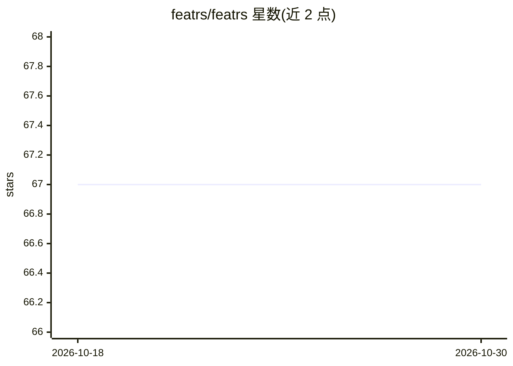

# featrs/featrs

⭐ 67 · Rust · MIT · 推送 2026-10-27 · [GitHub](https://github.com/featrs/featrs) · [官网](https://crates.io/crates/featrs) · 个人维护

**面向 Rust 开发者的 Polars 原生特征工程库**

基于 Polars 构建的 Rust 特征工程库，API 设计参考 scikit-learn，所有变换直接作用于 DataFrame 并保留列名。提供 60 余个组件，覆盖缩放（含按列统计自动选型的 AutoScaler）、类别编码、缺失值填充、时间序列特征（滞后/滚动/差分）、文本向量化（Count/TF-IDF/n-gram）、Pipeline/ColumnTransformer/CachedPipeline 管道、特征选择与数据质量诊断报告。以 crate 形式经 Cargo 安装，MIT 许可。

## 筛选速览

| 维度 | 判定 | 备注 |
|---|---|---|
| AI 角色 | `ai-native` | 本体是模型或模型工具 |
| 许可风险 | `permissive` | MIT |
| 部署形态 | `library` | 以包/库形式分发 |
| 模型依赖 | — | README 未给出锁定关系 |
| 硬件要求 | — | 无带数字的原话,不猜 |
| 安装摩擦 | `low` | 无编译、无系统依赖或容器化 |
| 成熟度 | — | 结构信号不足 |

## 能力要点

- 60 余个变换组件：缩放/编码/填充/时序/文本/选择等 10 类
- AutoScaler 与 AutoImputer 按列统计自动选择策略
- Pipeline、ColumnTransformer、ConditionalPipeline、CachedPipeline 等管道组件
- DataQualityReport 输出缺失、离群、基数与建议预处理

## 适用场景

- 在 Rust 机器学习流程中对 Polars DataFrame 做预处理
- 时间序列建模前生成滞后、滚动与差分特征
- 类别特征编码与缺失值自动处理
- 训练前检查数据质量并获得预处理建议

## 场景标签

 · 领域:机器学习/数据处理

## 证据(README 行号)

> L9: Feature engineering library for Rust, inspired by scikit-learn.
> L11: Built on Polars — all transformations operate natively on `DataFrame` and preserve column names.

## 星数曲线

2026-10-18 67 → 2026-10-30 67（+0）

---
*卡片 v1 · prompt 1.4 · 生成 2026-10-24 · 置信度 high · 依据 README sha `f3938144a6c8` · [字段定义](../../DATASET.md)*
