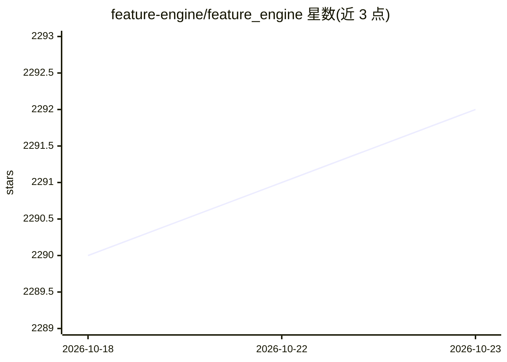

# feature-engine/feature_engine

⭐ 2,292 · Python · BSD-3-Clause · 推送 2026-09-19 · [GitHub](https://github.com/feature-engine/feature_engine) · [官网](https://feature-engine.trainindata.com/) · 组织维护

**面向机器学习的特征工程与特征选择 Python 库**

提供多个 transformer 做特征工程与特征选择，覆盖缺失值填补、分类编码、离散化、异常值处理、变量变换与创建、特征选择（RFE、MRMR、相关性剔除等）、日期/文本/时间序列特征与预处理，并附带 SklearnWrapper 与 Pipeline。transformer 遵循 Scikit-learn 的 fit()/transform() 接口，可与 sklearn 流程组合。通过 pip/conda 安装或源码克隆，面向使用 pandas/sklearn 做数据准备的开发者与科研人员。

## 筛选速览

| 维度 | 判定 | 备注 |
|---|---|---|
| AI 角色 | `ai-ecosystem` | LLM/agent 周边工具 |
| 许可风险 | `permissive` | BSD-3-Clause |
| 部署形态 | `library` | 以包/库形式分发 |
| 模型依赖 | — | README 未给出锁定关系 |
| 硬件要求 | — | 无带数字的原话,不猜 |
| 安装摩擦 | `low` | 无编译、无系统依赖或容器化 |
| 成熟度 | — | 结构信号不足 |

## 能力要点

- 缺失值填补、分类编码、离散化、异常值处理等大量 transformer
- 特征选择方法含 RFE、MRMR、相关性剔除、PSI、信息值等
- transformer 遵循 Scikit-learn fit()/transform() 接口
- 含日期、文本、时间序列（滞后/滑动窗口）特征与 sklearn 包装器

## 适用场景

- 建模前对 pandas 数据做缺失值填补与分类编码
- 通过 RFE/相关性剔除等流程缩减特征集
- 时间序列预测任务中构造滞后与窗口特征

## 场景标签

 · 领域:数据科学/机器学习工具库

## 证据(README 行号)

> L16: Feature-engine is a Python library with multiple transformers to engineer and select features for use in machine le
> L17: Feature-engine's transformers follow Scikit-learn's functionality with fit() and transform() methods to learn the

## 星数曲线

2026-10-18 2,290 → 2026-10-23 2,292（+2）

---
*卡片 v1 · prompt 1.4 · 生成 2026-10-21 · 置信度 high · 依据 README sha `7d61eadcceec` · [字段定义](../../DATASET.md)*
