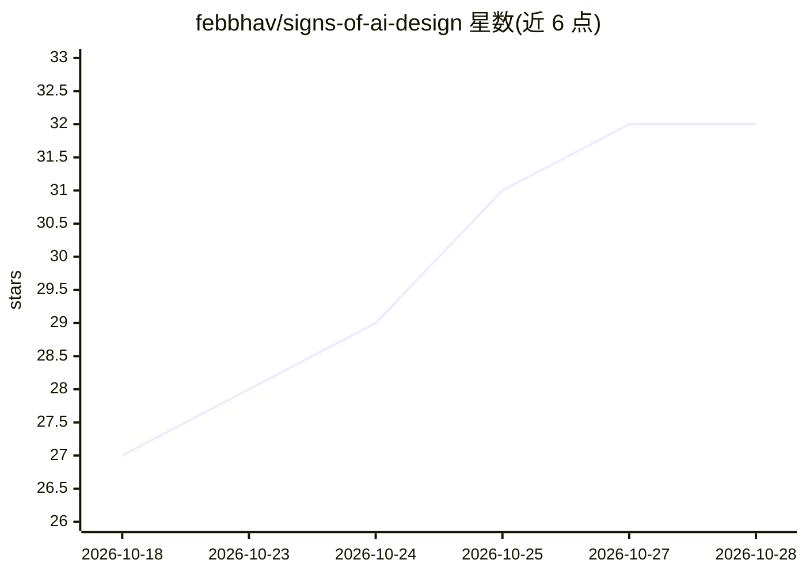

# febbhav/signs-of-ai-design

⭐ 32 · NOASSERTION · 推送 2026-07-31 · [GitHub](https://github.com/febbhav/signs-of-ai-design) · [官网](http://www.febian.com) · 个人维护

**AI 生成设计视觉特征指南：帮助识别与规避 AI 味设计**

一份关于 AI 生成设计（网站、界面、图像、视频、Logo、幻灯片等）视觉特征的结构化领域指南，仿照维基百科《AI 写作特征》编纂。每个条目列出识别要点、模型产生原因与误报情况，并标注可靠性（强/中/弱）与现状（是否仍适用于当前工具）。指南可双向使用：作为检测参考，或作为设计规则文件（design-rules.md）放入 CLAUDE.md、.cursorrules、AGENTS.md 或系统提示词中，让编码代理规避默认化的 AI 审美。内容按 CC BY-SA 4.0 授权，欢迎社区贡献。指南自述会随模型更新而衰减，故以仓库而非文章形式维护。

## 筛选速览

| 维度 | 判定 | 备注 |
|---|---|---|
| AI 角色 | `ai-knowledge` | 知识聚合/清单类 |
| 许可风险 | `none` | NOASSERTION |
| 部署形态 | `None` |  |
| 模型依赖 | — | README 未给出锁定关系 |
| 硬件要求 | — | 无带数字的原话,不猜 |
| 安装摩擦 | `low` | 无编译、无系统依赖或容器化 |
| 成熟度 | — | 结构信号不足 |

## 能力要点

- 条目含识别要点、成因、误报说明与可靠性/现状双标签
- design-rules.md 可作为 CLAUDE.md/.cursorrules/AGENTS.md 规则文件供编码代理使用
- 覆盖网站界面、图像、视频、Logo、幻灯片等多类视觉媒介
- 内容以 CC BY-SA 4.0 授权，支持复制、翻译与二次构建

## 适用场景

- 审查自己项目的设计是否落入 AI 默认模板
- 把设计规则文件放入编码代理配置，避免生成趋同的界面
- 了解当前 AI 生成设计常见的视觉特征与误报边界

## 场景标签

`精选清单` · 领域:学习与行业

## 证据(README 行号)

> L3: A field guide to the visual tells of AI-generated design: websites, app interfaces, images, video, logos, slide deck
> L11: This guide reads in two directions. As a detector, it tells you what to look for. As a rules file, it tells your co
> L21: Status describes whether the sign still applies to current tools. Models patch their tells. Hands were the canonica

## 星数曲线

2026-10-18 27 → 2026-10-28 32（+5）

---
*卡片 v1 · prompt 1.4 · 生成 2026-10-26 · 置信度 high · 依据 README sha `2b2d6647f55b` · [字段定义](../../DATASET.md)*
